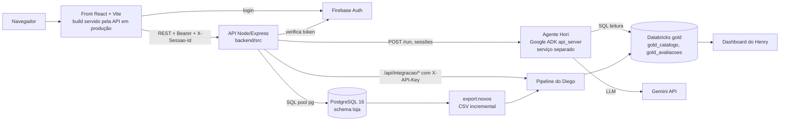
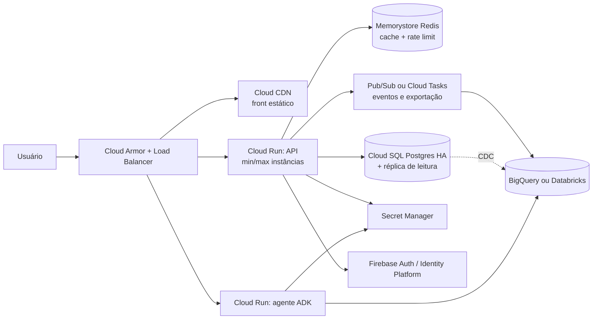

# Relatório de preparação para a banca: Lojas Horizonte (frente Full Stack)

Preparado em 22/11 a partir do repositório (branch `dev`, último commit `6ec8469`).
**Atenção:** a renovação de sessão no front (`frontend/src/services/api.js`, `carrinhoService.js`) e a atualização do `docs/API.md` estão **no disco, mas fora do commit `6ec8469`** (`git show --stat 6ec8469` lista só arquivos do back-end). Faça o commit antes da apresentação.
Regra usada: **toda afirmação tem origem** (arquivo, linha ou commit). O que não achei está como **NÃO ENCONTRADO**. O que o código contradiz na documentação está em **INCONSISTÊNCIAS** (seção 14).
Nenhum `.env` foi lido. Nenhum segredo, senha, token ou URL de banco aparece aqui.

A cola de véspera (2 páginas) está em [COLA_BANCA.md](COLA_BANCA.md).

---

## Fontes lidas e o que não encontrei

**Li:**

- `README.md`, `LEIA-ME.md`.
- `docs/PROJECT.md`, `docs/DECISIONS.md`, `docs/STATUS.md`, `docs/API.md`, `docs/DESIGN.md` (partes).
- `docs/architecture/gcp.md`, `docs/agile/` (risks, sla-incidentes, daily-reports).
- `docs/presentation/roteiro.md`, `docs/ai/DOCUMENTACAO_TECNICA.md`.
- `docs/analise/` (relatório de análise, backlog e relatório de correções), `docs/agentes/README.md`.
- Back-end: `backend/` (package.json, src/, db/init.sql, as 8 migrations, scripts/, docker-compose.yml, `.env.example` só com os nomes das variáveis).
- Front-end: `frontend/` (package.json, vite.config.js, src/).
- IA: `ai/` (pyproject.toml, agente_horizonte/, README.md).
- Dados: `data/catalogo.csv` (só cabeçalho e contagem).
- O `git log` completo.

**NÃO ENCONTRADO:**

| Item procurado | Situação |
|---|---|
| `INSTALACAO.md` e `DEPLOY.md` | não existem |
| Configuração do Render (`render.yaml`, `Procfile`, `Dockerfile`) | nenhum versionado (`git ls-files` sem resultado) |
| Contrato `SCHEMA_PIPELINE_v1.1` | não existe no disco nem no git (achado H-020, ADIADO) |
| `docs/contracts/*` e `docs/architecture/local.md` | existem, mas têm 0 bytes |
| Enunciado original do Projeto Integrador | não está no repositório |
| Teste de carga (k6, Locust) | nenhum arquivo nem script |
| Testes automatizados do front e do back | sem script `test` nos dois `package.json` |
| Uso do Codex | nenhuma menção |
| "Windows sem compilador para o agente" | nenhuma menção |
| "Banco fora do ar" como incidente | só aparece como risco em `docs/agile/risks.md` |
| Link da simulação de custo no GCP | `docs/architecture/gcp.md:19` tem só um marcador ("COLE_O_SEU_LINK...") |

---

## 0) Como estudar este documento

1. Leia a seção 1 (resumo) e decore os números da seção 1.3.
2. Leia a seção 4 (decisões), só a coluna "frase para falar".
3. Leia a seção 9 (escalabilidade): é a pergunta mais provável sobre a Black Friday.
4. Treine as perguntas da seção 11 em voz alta, principalmente as armadilhas.
5. Na véspera, revise só a [COLA_BANCA.md](COLA_BANCA.md) e ensaie a demo da seção 12.

---

## 1) Resumo executivo

### 1.1 As 4 dores da Lojas Horizonte

Fontes: `docs/PROJECT.md:7` e `README.md:6-11`.

1. **Site instável em pico.** Na última Black Friday o site ficou 40 minutos fora do ar.
2. **Dados espalhados.** ERP, site e marketplaces separados; a diretoria monta relatórios à mão em planilhas.
3. **Abandono de carrinho sem análise.**
4. **Nenhuma personalização.** Sem recomendação e sem atendimento automatizado.

### 1.2 O que eu construí

Uma loja virtual de moda funcionando de ponta a ponta:

- **Front-end:** React 19 + Vite 8, em JavaScript (JSX), estilo com CSS Modules. Fontes: `frontend/package.json:13-31` e `docs/DECISIONS.md` D-01/D-02.
- **Back-end:** API Node + Express 5, banco PostgreSQL 16 em Docker. Fontes: `backend/package.json:22-24` e `backend/docker-compose.yml`.
- **Login:** Firebase Authentication (Google e e-mail/senha). Fontes: `frontend/src/context/AuthContextProvider.jsx` e D-10.
- **Fluxo de compra completo:** catálogo com busca e filtros, produto, favoritos, cesta, checkout simulado (Pix, crédito em 1 a 12x, débito), perfil com endereços, meus pedidos, cancelamento e avaliações. Fonte: `frontend/src/App.jsx:27-55`.
- **Chat com a assistente de IA "Hori",** do Emanuel, por meio da rota `/api/chat`. Fontes: `backend/src/routes/chat.js` e `frontend/src/components/ChatWidget/`.
- **Eventos do funil** (visita, ver produto, adicionar à cesta, iniciar checkout, compra) gravados pelo back-end. Fonte: `backend/src/services/analyticsService.js`.
- **Exportação para a Engenharia de Dados:** rotas `/api/integracao/*` e o script `export:novos`, que gera CSV. Fontes: `backend/src/routes/integracao.js` e `backend/scripts/export-novos.js`.

### 1.3 Números-chave

Todos medidos por comando em 22/11.

| Número | Valor | Como medi |
|---|---|---|
| Commits no repositório | 165 (70 meus) | `git rev-list --count HEAD`; `git shortlog -sn HEAD` |
| Rotas da API | 29 | `grep -cE "router\.(get\|post\|put\|patch\|delete)\(" backend/src/routes/*.js` |
| Tabelas no banco (schema `loja`) | 8 | `grep -c "CREATE TABLE IF NOT EXISTS loja" backend/db/init.sql` |
| Migrations | 8 (001 a 008) | `ls backend/db/migrations` |
| Telas (páginas) | 13 | `ls frontend/src/pages` |
| Produtos no catálogo | 200, em 9 categorias | `data/catalogo.csv`; `docs/API.md:16` |
| Achados da análise de qualidade | 116; 71 corrigidos, 37 abertos | `docs/analise/backlog_correcoes.md`; `docs/analise/RELATORIO_CORRECOES_2026-11-18.md:7-14` |

### 1.4 Como minha parte se liga ao grupo

Papéis conforme `docs/PROJECT.md:40-48`.

- **Diego (Dados):** consome os pedidos, itens, eventos e avaliações que o site gera, pelas rotas `/api/integracao/*` ou pelo CSV do `export:novos`. Ele monta o pipeline Medallion no Databricks.
- **Emanuel (IA):** o agente "Hori" roda como serviço separado (Google ADK). O site conversa com ele pelo meu back-end, na rota `/api/chat`. O agente lê o catálogo e as avaliações direto da camada gold do Databricks. Fontes: `docs/ai/DOCUMENTACAO_TECNICA.md:166-167` e `backend/src/services/adkClient.js`.
- **Henry (BI):** usa a gold do Diego; o abandono de carrinho é calculado no BI a partir dos eventos que eu gravo. Fonte: `docs/presentation/roteiro.md:24`.
- **Filipe (PMO):** cuida de riscos, SLA, custo no GCP e roteiro. Fontes: `docs/agile/*` e `docs/architecture/gcp.md`.

---

## 2) Linha do tempo

Fonte: `git log --date=short`. Os marcos ficam no início de cada linha.

| Data | Marco | Commit de referência | Por que nessa ordem |
|---|---|---|---|
| 12/11 | Repositório criado | `392896d` | — |
| 13–14/11 | Decisões de base (D-01 a D-19): React, CSS Modules, sem mock | `docs/DECISIONS.md` | Primeiro decidir a stack e as regras de trabalho com agentes |
| 15/11 | Base do front: Firebase, Header, rotas, Login; telas estruturadas sem dados (Home, Catálogo, Produto) | `ace0cb4`, `54beed5`, `7607d58`, `1507244` | D-19: sem dados falsos, então primeiro a estrutura e os estados (carregando, erro, vazio) |
| 16/11 | Telas de Favoritos, Cesta, Checkout e Pedidos | `daedb9b`, `e06b7b2` | Fechar o fluxo de compra na interface |
| 17/11 | Identidade visual e temas (D-24); ChatWidget (só a interface); back-end B1 a B3b (Postgres, catálogo, autenticação, carrinho e pedidos, eventos, integração) | `2515519`, `e722a5a`, `c12af20`, `2f8ee3d`, `f47ce86`, `98c9719` | O dataset do Diego chegou e o back-end começou |
| 18/11 | Front e back unificados na branch `dev`; telas ligadas à API real (tarefas 4A e 4B); análise com 116 achados e correções em fases | `0385009`, `952479a`, `4275e27`, `7db5d6b`, `8277a42`, `3353ab3` | Integrar e depois auditar antes de seguir |
| 19/11 | Catálogo v2 na API (migração 006); avaliações (migração 007); CEP pelo ViaCEP | `c8beca9`, `4ec566e`, `32fb8ee` | Dados reais do Diego (descrição, cor, ocasiões) |
| 20/11 | Agente Hori do Emanuel entra na `dev`; `/api/chat` e o ChatWidget ligados ao ADK; Markdown seguro no chat | `ed8a34d`, `bf901d9`, `3cc149b` | O agente ficou pronto no dia 20 |
| 21/11 | Documentação técnica da IA | `e3d440a` | — |
| 22/11 | Avatar e estados da Hori; funil gravado na transação da compra e novo export de avaliações (migração 008); renovação de sessão no front ainda sem commit | `d167b73`, `6ec8469` | Pedido do Emanuel e correções pedidas pelo Diego a partir dos dados reais |

---

## 3) Arquitetura

### 3.1 Como foi construída

O deploy no Render é informação do Caio: a configuração do Render **não está versionada** (NÃO ENCONTRADO). O código está preparado para isso: em produção, a API serve o build do front (`backend/src/app.js:107-120`) e o banco aceita TLS (`backend/src/dbConfig.js`, variável `DATABASE_SSL`).

Fontes:

- Rotas: `backend/src/app.js:89-99`.
- Cliente do agente: `backend/src/services/adkClient.js`.
- Tabelas que o agente lê: `docs/ai/DOCUMENTACAO_TECNICA.md:166-167`.
- Integração: `backend/src/routes/integracao.js`.
- Export: `backend/scripts/export-novos.js`.

### 3.2 Versão "ideal no GCP", para comparar

Base do grupo: `docs/architecture/gcp.md:6-9` e `README.md:21-27`, com Cloud Run, Cloud SQL, BigQuery e Firebase Auth.
O que acrescentei como proposta, **não implementado**: Redis, Pub/Sub, CDN, Cloud Armor e Secret Manager.

---

## 4) Decisões e porquês

Colunas: **Onde** = arquivo ou commit. **Frase** = o que posso falar em voz alta.
"Alternativas" e "custo" só aparecem quando há registro; senão, está escrito "não registrado".

### 4.1 Decisões do `docs/DECISIONS.md` (31 linhas)

| ID | Decisão | Alternativas | Por que | Custo/limitação | Onde | Frase |
|---|---|---|---|---|---|---|
| D-01 | React + Vite com JSX, sem TypeScript | TypeScript | Eu prefiro JSX e o grupo usa JS | Menos checagem de tipos | `frontend/package.json` | "Usei React com Vite em JavaScript, que é o que o grupo domina." |
| D-02 | CSS Modules + tokens | Tailwind, kits de UI (proibidos em `frontend/src/AGENTS.md`) | O briefing pede "CSS puro"; CSS Modules é CSS comum com escopo por componente | Mais CSS escrito à mão | `frontend/src/styles/tokens.css`; 79 arquivos `.module.css` | "É CSS puro, só que cada componente tem o seu, sem vazar estilo." |
| D-03 | Sem Zod, TanStack, MSW, React Hook Form, axios | Essas libs | Prazo curto e eu estava aprendendo | Mais código próprio | `frontend/package.json` | "Cada biblioteca nova era um risco no prazo; usei o básico." |
| D-04 | `fetch` nativo, Context e hooks próprios | axios, TanStack Query | Mesmo motivo do D-03 | Sem cache automático no front | `frontend/src/services/api.js`, `frontend/src/hooks/` | "A tela pede dados a um hook; só o hook fala com a API." |
| D-05 | "Mock primeiro", substituída pela D-19 | — | — | — | `docs/DECISIONS.md:11` | — |
| D-06 | Filtros: preço, tamanho, categoria | Cor, marca, estilo | Marca e estilo não existem nos dados | — | `backend/src/queries/produtosQueries.js` | "Filtrei pelo que existe nos dados." |
| D-07 | Escolher tamanho e cor antes de pôr na cesta | — | Meu pedido | — | `frontend/src/pages/Produto/` | — |
| D-08 | Favoritos no escopo | — | Meu pedido | — | `backend/src/routes/favoritos.js` | "Favoritos foi um extra além do enunciado." |
| D-09 | Endereços em tabela própria | Endereço dentro do usuário | Normalização | O pedido não guarda cópia do endereço (H-045, ADIADO) | `loja.enderecos` em `backend/db/init.sql:60-78` | "Um cliente pode ter vários endereços e escolhe um no checkout." |
| D-10 | Login com Google e e-mail/senha | Apple, Facebook | Firebase gratuito; os outros exigem contas extras | — | `AuthContextProvider.jsx:52-79` | "Não guardo senha: o Firebase cuida disso." |
| D-11 | Recuperar senha por link | Código | O Firebase não envia código | — | `AuthContextProvider.jsx:79` | — |
| D-12 | Checkout simulado (versão original: Pix, cartão, boleto) | — | Escopo do MVP | Revisada em 18/11 | `docs/DECISIONS.md:18` | — |
| D-12 (revisão) | Pix, crédito 1 a 12x sem juros, débito; boleto sai | Boleto | Alinhar com a API | `BOLETO` continua aceito no CHECK do banco (`init.sql:102`) | `backend/src/queries/pedidosQueries.js:12,84-85` | "Três formas de pagamento, todas simuladas." |
| D-13 | Desktop em 1440 px; CSS mobile-first | — | O Figma só tinha mobile | — | 58 ocorrências de `@media` no front | — |
| D-14 | Sem marcas nem fotos reais | Fotos | Direitos de imagem | Sem fotos de produto | `ProductImage.jsx`, `ProductSilhouette.jsx` | "Uso silhuetas desenhadas e pintadas na cor da peça." |
| D-15 | Contexto em arquivos `docs/`, sem "agente de memória" | Memória do modelo | Arquivo versionado não alucina | — | `docs/` | "O que o agente sabe está escrito em arquivo, não na cabeça dele." |
| D-16 | Cada agente só edita as próprias pastas | — | Evita conflito entre agentes | — | `frontend/src/AGENTS.md` | — |
| D-17 | O agente entrega a sugestão de commit; quem commita sou eu | Agente commitando | Registro e evidência para o PMO | — | `frontend/src/AGENTS.md:96-117` | "Nenhum agente fez commit; todo commit passou por mim." |
| D-18 | Arquivos sensíveis no `.gitignore`; `git status` antes de commit | — | Evitar vazar chaves | Uma chave já tinha vazado (H-002) | `.gitignore` | — |
| D-19 | Sem dados mockados | Mock | Esperar o dataset do grupo | O front ficou dias sem dados | `docs/DECISIONS.md:24` | "Nada na tela é inventado; o que é simulado está escrito SIMULADO." |
| D-20 | Header simples; ícones só para quem está logado | — | Simplificar | Emendada no mesmo dia | `docs/DECISIONS.md:26` | — |
| D-20 (emenda) | Navegação: Início, Novidades, Masculino, Feminino + tema | — | Arquitetura de navegação da marca | — | `frontend/src/components/Header/` | — |
| D-21 | Estoque fora do MVP; tamanhos, cores e descrições gerados no seed (SIMULADO) | Estoque real | Reduzir complexidade | Ver INCONSISTÊNCIA 11 | `docs/DECISIONS.md:27`; `docs/contrato/tamanhos.json` | "Estoque ficou fora; seria o próximo passo." |
| D-22 | O id público do produto é o SKU | id numérico | Evita id artificial | — | `produtosQueries.js:17` | "O produto é achado pelo SKU, igual ao catálogo do Diego." |
| D-23 | Eventos do funil gravados pelo back-end; o front só manda `X-Sessao-Id` | Analytics no navegador | Centralizar e não confiar no navegador | O funil depende do cabeçalho; corrigido em `6ec8469` | `backend/src/services/analyticsService.js` | "Quem grava o evento é o servidor, não o navegador." |
| D-24 | Paleta terrosa, temas claro e escuro, fonte Jost | — | Identidade da marca e contraste WCAG | — | `frontend/src/styles/tokens.css` | — |
| D-24 (revisão) | Tokens refinados, `--color-field-border`, Logo; tema aplicado no `<head>` | — | WCAG 1.4.11; sem "piscar" o tema | — | `frontend/index.html:8-16` | — |
| D-25 | Novidades = o SKU mais recente de cada categoria (SIMULADO) | — | Variedade na vitrine | Critério simulado | `produtosQueries.js` | — |
| D-26 | Páginas legais com aviso acadêmico | — | Transparência | — | `frontend/src/pages/Privacidade/` etc. | "Explico na página de privacidade o que guardo." |
| D-27 | Frete fixo `FRETE_SIMULADO` (padrão R$ 15,00) | Transportadora | Simplicidade e honestidade | Não é frete real | `backend/src/queries/carrinhoHelpers.js:29-31` | "Frete fixo e simulado; não integrei transportadora." |
| D-28 | Proxy do chat para `ADK_URL` (versão provisória: timeout de 20 s) | — | Desacoplar a IA; 503 gracioso | **Desatualizada**: hoje é `/run`, com padrão de 60 s (INCONSISTÊNCIA 9) | `backend/src/services/adkClient.js:47` | — |

### 4.2 Decisões que não estão no DECISIONS.md, mas estão no código

| Decisão | Alternativas | Por que | Custo/limitação | Onde | Frase |
|---|---|---|---|---|---|
| **Preço:** o banco guarda **reais** em `NUMERIC(10,2)`; a API calcula em **centavos** e devolve reais | Centavos inteiros no banco | Somar em centavos inteiros evita erro de arredondamento | **ATENÇÃO:** a premissa "centavos no banco" está errada (INCONSISTÊNCIA 1) | `backend/db/init.sql:24,103-105,133`; `carrinhoHelpers.js:30,46-75`; `pedidosQueries.js:182-198` | "O banco guarda em reais com duas casas; a conta é feita em centavos para não errar arredondamento." |
| Usuário identificado por **hash** (sha256, 16 hex) na exportação e no agente | E-mail ou UID | Privacidade: o pipeline e a IA não recebem dado pessoal | Hash sem salt (H-115, ABERTO) | `avaliacoesQueries.js:10-16`; `init.sql:167,186`; `chat.js` (userId) | "Para os dados e para a IA, o cliente vira um código; nunca e-mail." |
| **Sem dado de cartão:** a rota só lê `enderecoId`, `formaPagamento` e `parcelas` | Formulário de cartão | Não guardar dado sensível; checkout é simulado | Não é pagamento real | `backend/src/routes/carrinho.js:67-68`; `PaymentOptions.jsx:7-27,109` | "Não peço número de cartão; nem chega ao servidor." |
| **Frete fixo simulado** | — | Ver D-27 | — | — | — |
| **Só quem comprou avalia:** precisa de pedido FINALIZADO com o SKU; uma avaliação por produto; editável, sem excluir | Qualquer usuário avaliar | Confiança das avaliações | Cancelado não conta | `avaliacoesQueries.js:163-199`; `init.sql:206` | "O servidor confere se existe pedido finalizado com aquele produto antes de aceitar." |
| **Export incremental com marca** (`updated_at`, janela de 5 min, sem repetir linha) | Export completo sempre | Não reenviar tudo; avaliação editada volta | Entrega "pelo menos uma vez": o consumidor deduplica | `export-novos.js:36-61,145-171`; `integracaoQueries.js:34-49` | "Cada lote leva só o que mudou desde o último." |
| **Tokens de teste só fora de produção** e com a flag ligada | Sem tokens de teste | Testar sem Firebase | Era uma falha crítica (H-001), corrigida | `backend/src/middlewares/auth.js:7-12,29-38` | "Token de teste só existe com a flag ligada e nunca em produção." |
| **Contrato SCHEMA_PIPELINE_v1.1 com o Diego** | — | Combinar as colunas dos CSVs | **Arquivo NÃO ENCONTRADO** (H-020); as colunas reais estão no código | `backend/src/routes/integracao.js:13-66`; `docs/API.md` | "As colunas estão fixas no código e no API.md; o documento formal ficou com o Diego." |
| **Chat via proxy** no back-end, não direto do navegador ao agente | Navegador → ADK | O ADK não autentica por si (`DOCUMENTACAO_TECNICA.md`, seção 9: "separação por userId sozinha não autentica"); o servidor valida, limita e não expõe e-mail | Mais um salto de rede | `backend/src/routes/chat.js`; `adkClient.js` | "O navegador nunca fala com a IA direto; o meu servidor valida e filtra." |
| **Só a resposta final do agente chega ao cliente** (descarta chamada de ferramenta, resultado, raciocínio e JSON cru) | Repassar os eventos | Não vazar dados internos | Se não houver texto: 502 | `adkClient.js` (`extrairTextoFinal`, `pareceSaidaInterna`) | "O cliente só vê o texto final da Hori, nunca o que ela consultou." |
| **"Tudo local" → Render** | Local com Docker | Segundo o Caio | Configuração NÃO ENCONTRADA no repositório; `gcp.md:2` ainda diz "local" | `app.js:107-120` (serve o front); `dbConfig.js` (TLS) | "Preparamos a API para servir o site e falar com banco gerenciado." |
| **DESCARTADO: formulário de cartão** | Pedir número do cartão | Motivo não registrado em arquivo; segundo o Caio, não guardar nem trafegar dado de cartão | — | `PaymentOptions.jsx:109` (aviso "nenhum dado de cartão") | "Tirei o formulário de propósito: não faz sentido coletar cartão num simulador." |
| **DESCARTADO: prazo de cancelamento** | Janela de tempo para cancelar | Decisão D15 do processo de correção, sem item associado (`backlog_correcoes.md:153`); motivo não registrado | Cancela qualquer pedido finalizado | `pedidosQueries.js` (cancelamento); confirmação em `OrderCard.jsx:22,184-196` | "Cancelar pede confirmação, mas não tem prazo; seria regra de negócio a definir com o cliente." |
| **Funil gravado na transação da compra; sessão renovada após compra e 30 min de inatividade** | Gravar depois do COMMIT | Pedido do Diego: compras sem purchase e sessões de 17 h | — | commit `6ec8469`; `analyticsService.js`; `frontend/src/services/api.js` | "Se a compra falhar, o evento também não fica; e cada compra fecha a sessão." |

---

## 5) Como foi desenvolvido

### 5.1 Processo

- **Agentes de IA orientados por prompts e regras em arquivo.**
  - Fase do front com o Antigravity, com 4 papéis: UI, Dados, Design e Revisor (`docs/agentes/README.md:3-10`; regras em `.agent/rules/`).
  - Depois, Claude Code com orquestradores de análise e correção e 12 subagentes (`kit-claude-horizonte/`, `.claude/agents/`).
  - **Codex: NÃO ENCONTRADO** no repositório.
- **Regra de ouro:** o agente nunca faz commit nem push; ele entrega a sugestão de commit e quem commita sou eu (`frontend/src/AGENTS.md:96-117`; D-17).
- **Branches:** front e back foram unificados na `dev` em 18/11 (`0385009`); `main` recebe merges. O Diego trabalhou com PRs: 14 merges de pull request (`git log --merges | grep -c "Merge pull request"`).
- **Revisão:** em 18/11, a análise com 7 agentes em 2 ondas gerou 116 achados. As correções foram feitas em fases (banco/back → dados do front → telas), cada uma com um revisor independente (`docs/analise/RELATORIO_CORRECOES_2026-11-18.md:20-25`).

### 5.2 Qualidade: o que foi testado e como

| Verificado | Como | Origem |
|---|---|---|
| Lint e build do front | `npm run lint` e `npm run build`, rodados a cada entrega | registro das entregas; o build passa (aviso de bundle > 500 kB) |
| API do back-end | Correções da Fase 1 com 109 verificações em Postgres descartável | `RELATORIO_CORRECOES_2026-11-18.md:22` |
| Funil e export (22/11) | Postgres descartável e API em processo próprio: ordem dos eventos, transação, reenvio, sessões | commit `6ec8469` (scripts de teste fora do repositório) |
| Chat (20/11) | Servidor falso do ADK: só o texto final sai; erros 502, 503 e 504 | commit `bf901d9` (script fora do repositório) |
| Hori (22/11) | Chrome headless em 360 e 1440 px, nos dois temas | commit `d167b73` (capturas fora do repositório) |
| Agente de IA | 131 funções de teste em `ai/agente_horizonte/tests` | `grep -rh "def test_"`; **não rodei esses testes** |

**O que NÃO foi testado:**

- Nenhum teste automatizado no front nem no back: sem script `test` (H-113, ABERTO).
- Nenhum teste de carga (NÃO ENCONTRADO).
- Fluxos de tela pelos agentes: "Os fluxos de tela não foram testados pelos agentes" (`RELATORIO_CORRECOES_2026-11-18.md:16`).
- A revisão responsiva está desmarcada (`docs/STATUS.md:68`).
- Conversa real com o agente pelo site e comportamento real no Render: NÃO VERIFICADO.
- **Atenção:** relatórios antigos de agentes afirmaram testes que não aconteceram (H-085; `docs/relatorios/relatorio18-11-2026-consolidado.md:9`, que diz "100% aprovado"). Não repita esses números.

### 5.3 Maiores problemas e como resolvemos

| Problema | O que aconteceu | Como resolvemos | Origem |
|---|---|---|---|
| Chave da integração publicada | O valor estava em `test-b3b.js` no `origin/dev` | Chave tratada como vazada e trocada (D2); o script passou a ler do ambiente | H-002 em `backlog_correcoes.md:19` |
| Bypass de autenticação | `test:` autenticava qualquer usuário fora de produção | Exige `ALLOW_TEST_TOKENS=true` **e** não estar em produção | H-001; `auth.js:7-12` |
| Catálogo v2 | Chegou com descrição, cor e ocasiões novas | Migração 006 e front com descrição real e cor nula | `c8beca9`, `0f5f49f` |
| Sem migrações / Render | `init.sql` só roda com volume vazio; no Render nada criava as tabelas | Migrador próprio com checksum | H-021; `backend/scripts/migrar.js` |
| Funil inconsistente nos dados reais | Compras sem purchase, sessão sem session_start, sessão de 17 h | Eventos na transação, trava por sessão, renovação de sessão | `6ec8469` |
| Chat sem formato do ADK | O proxy antigo esperava `{resposta}` | Adaptador com o contrato `/run` | `bf901d9` |
| Banco fora do ar | NÃO ENCONTRADO como incidente | — | só como risco em `docs/agile/risks.md` |
| Windows sem compilador para o agente | NÃO ENCONTRADO | — | — |
| Deploy | NÃO ENCONTRADO (sem configuração versionada) | — | — |

---

## 6) As 4 dores → solução

| Dor | O que existe | Parcial | Falta |
|---|---|---|---|
| 1. Instabilidade em pico | API sem estado de sessão (token Firebase); paginação com no máximo 48 itens (`produtosQueries.js:57,105`); índices (`init.sql`); `/api/health`; limite de requisições (`limitador.js`); proposta em Cloud Run (`gcp.md`) | O limite é por instância, em memória | Teste de carga, cache, réplica e autoscaling: nada disso foi feito; é proposta |
| 2. Dados fragmentados | O site gera pedidos, itens, eventos e avaliações com colunas fixas e hash (`integracao.js`); export incremental (`export-novos.js`); o Diego une ERP + Olist + site no Databricks | Contrato formal NÃO ENCONTRADO (H-020) | Ingestão automática (hoje é CSV ou chamada manual) |
| 3. Abandono de carrinho | Eventos `add_to_cart`, `begin_checkout`, `purchase` e `ultima_etapa` do carrinho (`init.sql:95-121,147-162`) | O cálculo do abandono fica no BI (`docs/presentation/roteiro.md:24`); no back-end não há (`grep abandon` vazio) | Ação sobre o abandono (e-mail, lembrete) |
| 4. Personalização | Chat com a Hori (busca BM25 no catálogo e nas avaliações); "semelhantes" da mesma categoria (`useSemelhantes.js`); filtros | Cartões de produto no chat quase nunca aparecem, porque o agente oculta SKUs (INCONSISTÊNCIA 12) | Recomendação no carrinho (citada no README e no roteiro; NÃO ENCONTRADA no front) |

---

## 7) Integração com o grupo

- **Rotas** `/api/integracao/pedidos`, `/pedido-itens`, `/eventos` e `/avaliacoes` (`integracao.js:112-160`).
  - Autenticação pelo cabeçalho `X-API-Key`; o valor nunca é mostrado.
  - Parâmetros: `desde` (ISO UTC), `limite` (1 a 20000) e `formato=csv`.
  - Limite de 60 requisições por minuto por IP (`app.js:73-80`).
- **CSV** (`integracaoQueries.js:15-32`): vírgula, cabeçalho na primeira linha, datas em UTC com "Z".
- **Colunas** (`integracao.js:13-66`):
  - pedidos (12): `pedido_id … parcelas`
  - itens (9)
  - eventos (11)
  - avaliações (10, desde a migração 008): `avaliacao_id, pedido_id, sku, usuario_hash, nota, titulo, comentario, avaliado_em, updated_at, origem`, com `origem = APP`
- **Privacidade:** sai o `usuario_hash`, nunca UID, e-mail ou nome (`init.sql:167,186`).
- **Como o agente consome o catálogo:** ele **não** usa a minha API. Lê `horizonte.gold.gold_catalogo` e `horizonte.gold.gold_avaliacoes` no Databricks, monta um índice BM25 em memória e responde pelo ADK (`docs/ai/DOCUMENTACAO_TECNICA.md:116,166-167,218-261`).

---

## 8) Segurança e privacidade

**O que existe:**

| Item | Onde |
|---|---|
| Firebase Auth; o token é verificado no servidor; rotas privadas exigem Bearer | `backend/src/middlewares/auth.js` |
| Autorização por usuário: endereço e pedido só do próprio dono | `pedidosQueries.js` (endereço do usuário, senão 404) |
| Validação de entrada (ids, datas, tamanho de texto, caractere nulo) | `utils/validacao.js`; `integracao.js:54-108`; `chat.js` |
| Limite de requisições: chat 30/min por IP e 20/min por usuário; integração 60/min | `app.js:65-80`; `chat.js` |
| CORS com lista de origens; cabeçalhos de segurança; JSON até 100 kB; erro 500 sem stack trace | `app.js` |
| Nenhum dado de cartão | `carrinho.js:67-68` |
| Hash do usuário no export e no agente | `avaliacoesQueries.js:10-16` |
| Chave de integração comparada em tempo constante | `authIntegracao.js` |
| Chat: o texto do assistente nunca vira HTML; links só http(s) | `frontend/src/utils/markdown.js` |

**O que NÃO existe ou ficou aberto:**

- Hash sem salt (H-115).
- `npm audit` com 8 vulnerabilidades altas (H-084).
- Sem HSTS e sem CSP fora de `/api`.
- O limite de requisições não vale entre instâncias.
- A chave vazada continua no histórico do git (foi trocada, não apagada).
- O comentário da avaliação é texto livre e pode conter dado pessoal.
- Sem política de retenção nem de exclusão de conta.

**LGPD em linguagem simples:**

- Guardo só o necessário para vender: nome, e-mail, telefone opcional, endereço e pedidos (`init.sql:46-78`).
- Senha fica com o Firebase, não comigo.
- Dado de cartão eu nem recebo.
- Para análise e IA, o cliente vira um código (hash), nunca o nome.
- O que eu ainda não tenho: um jeito de o cliente pedir para apagar os dados, uma política de retenção e o salt no hash. A página de privacidade explica o que é usado (D-26).

---

## 9) Escalabilidade e picos (Cloud Run)

**Limitação conhecida:** o MVP **não foi testado sob carga**. Não tenho número de capacidade. Tudo abaixo é análise do código e proposta.

Atenção também: o **Cloud Run roda a aplicação; os dados ficam no banco** (Cloud SQL). Se a instância morre, nada se perde, porque nada fica guardado nela.

### 9a) O que o código já favorece

| Item | Situação | Onde |
|---|---|---|
| Sem sessão no servidor | O login é um token do Firebase verificado a cada requisição | `auth.js` |
| Configuração por variáveis de ambiente | Porta, origens, banco, chaves e agente | `backend/.env.example` (16 variáveis) |
| Rota de saúde | `GET /api/health` | `backend/src/routes/health.js` |
| Paginação | Catálogo com no máximo 48 por página; export com no máximo 20000 | `produtosQueries.js:57`; `integracao.js` |
| Índices | Categoria, ordem, popularidade, `updated_at`, (sessão, data) | `init.sql:17-39,161-162` |
| Pool de conexões | `pg.Pool` com timeouts de conexão e de consulta | `backend/src/db.js:11-19` |
| Atrás de proxy | `trust proxy` configurado | `app.js:26` |
| Agente em serviço separado | Escala e cai sem derrubar a compra (chat devolve 503) | `adkClient.js` |

### 9b) O que NÃO escalaria como está

| Ponto | Gravidade | Por quê | Onde |
|---|---|---|---|
| Banco único, sem réplica | **Alta** | Tudo depende de um Postgres | `docker-compose.yml` |
| Limite de requisições em memória | **Alta** | Com 10 instâncias, o limite real fica 10 vezes maior; zera ao reiniciar | `limitador.js:1-35`; `chat.js` |
| Agente: índice BM25 em memória e sessões em SQLite local | **Alta** | Cada instância carrega tudo e as sessões não são compartilhadas | `DOCUMENTACAO_TECNICA.md` seção 9 |
| Pool sem `max` explícito | Média | O padrão da biblioteca `pg` vale por instância; instâncias × pool podem esgotar o banco | `db.js:11` |
| Sem cache do catálogo | Média | Toda visita ao catálogo consulta o banco | `grep cache backend/src` vazio |
| Export síncrono (até 20000 linhas na requisição) | Média | Ocupa a API e o banco no horário do pico | `integracao.js`; `integracaoQueries.js` |
| Eventos do funil: uma transação com trava por evento | Média | Mais escritas por clique | `analyticsService.js` |
| Token do Firebase verificado duas vezes por requisição | Baixa | CPU extra | `analyticsService.js` (middleware) + `auth.js` |
| Databricks Free sem SLA (o agente depende dele) | Alta para o chat | Pode suspender por cota | `DOCUMENTACAO_TECNICA.md` seção 9 |

### 9c) Arquitetura-alvo no GCP

- **Cloud Run:** API e agente em serviços **separados**, cada um com mínimo e máximo de instâncias.
  - **Concorrência por instância:** quantas requisições uma instância atende ao mesmo tempo. O Cloud Run permite configurar.
  - **Mínimo de instâncias:** deixa instâncias "quentes" antes da campanha, sem partida a frio.
  - **Máximo de instâncias:** protege o banco. A regra é **instâncias × tamanho do pool ≤ conexões que o banco aceita (menos uma folga)**. Exemplo de conta, não medição: pool de 10 com banco de 100 conexões dá no máximo ~9 instâncias.
- **Cloud SQL Postgres** com alta disponibilidade e **réplica de leitura** para o catálogo.
- **Memorystore (Redis):** cache do catálogo e limite de requisições **distribuído**.
- **Front estático em CDN** (Cloud CDN / Storage).
- **Pub/Sub ou Cloud Tasks** para o que não precisa ser síncrono: gravar eventos e gerar a exportação.
- **Cloud Armor** (proteção contra abuso e DDoS) e **Secret Manager** (chaves fora do código).
- **IAM com contas de serviço de menor privilégio:**
  - API: só Cloud SQL Client e os segredos dela.
  - Agente: só leitura no warehouse e o segredo do Gemini.
  - Exportação: só leitura das views.
- **BigQuery ou Databricks** para análise, sem pesar o banco da loja.

### 9d) Plano para a Black Friday

1. **Linha de base:** medir hoje a latência p95 e a taxa de erro do catálogo, da cesta e da compra.
2. **Teste de carga** (k6 ou Locust) com o roteiro real (ver → cesta → comprar), semanas antes. Hoje **não existe**.
3. **SLOs:** o PMO propôs p95 < 500 ms e disponibilidade de 99,9% (`docs/agile/sla-incidentes.md:4-5`). Adicionar a meta de taxa de erro.
4. **Alertas:** p95, erro 5xx, conexões do banco e cota do Gemini.
5. **Mínimo de instâncias** elevado antes da campanha; máximo calculado pelo banco.
6. **Degradação graciosa:** desligar o chat e as recomendações antes de deixar a compra cair. O chat já devolve 503 sem quebrar a página (`adkClient.js`).
7. **Runbook e rollback:** voltar para a revisão anterior do Cloud Run com um comando; fluxo de incidente em `sla-incidentes.md:7-12`.

### 9e) GCP × AWS × Azure

| Peça | GCP | AWS | Azure |
|---|---|---|---|
| Containers sem servidor | Cloud Run | App Runner / ECS Fargate | Container Apps |
| Postgres gerenciado | Cloud SQL | RDS / Aurora | Database for PostgreSQL |
| Cache | Memorystore | ElastiCache | Cache for Redis |
| CDN | Cloud CDN | CloudFront | Front Door / CDN |
| Fila | Pub/Sub, Cloud Tasks | SQS / SNS | Service Bus |
| WAF | Cloud Armor | AWS WAF | Front Door WAF |
| Segredos | Secret Manager | Secrets Manager | Key Vault |
| Data warehouse | BigQuery | Redshift | Synapse / Fabric |

**Custo:** não invento preço; **consultar a calculadora do provedor**.

- Entram na conta: vCPU e memória × horas das instâncias, requisições, tamanho e alta disponibilidade do Cloud SQL, armazenamento, tráfego de saída, Redis, consultas e armazenamento do BigQuery, chamadas ao Gemini.
- O `docs/architecture/gcp.md:11-18` tem uma estimativa do PMO ("~US$ 450/mês"), **sem o link da simulação**. Trate como estimativa não verificada.

---

## 10) Limitações e dívida técnica

### 10.1 Limitações conhecidas

- Sem testes automatizados no front e no back (H-113).
- Sem teste de carga.
- 37 achados abertos e 4 adiados (backlog).
- Simulações declaradas: pagamento, Pix, frete fixo, tamanhos gerados por regra, novidades.
- Sem estoque (D-21).
- O pedido não copia o endereço (H-045).
- O agente oculta SKUs, então os cartões no chat quase não aparecem.
- Deploy no Render sem configuração versionada.
- Documentação com divergências (seção 14).

### 10.2 O que eu faria com mais tempo, em ordem

1. Testes automatizados das rotas de compra e avaliação, e um teste de carga básico.
2. Limite de requisições e cache no Redis; `max` do pool explícito.
3. Copiar o endereço no pedido; salt no hash; retenção e exclusão de dados (LGPD).
4. Contrato formal com o Diego versionado; export assíncrono.
5. Combinar com o Emanuel um campo de produtos na resposta do agente, para mostrar os cartões no chat.
6. Atualizar `README.md`, `gcp.md` e `DECISIONS.md` (D-28) com o que existe de verdade.

---

## 11) Perguntas prováveis da banca

1. **"E se o Render cair?"** O site sai do ar; hoje há uma instância só. O que temos: rota `/api/health` para monitorar e dados no banco, não na instância. Na proposta (Cloud Run + Cloud SQL HA), outra instância assume e o banco tem réplica. A configuração do Render não está versionada no repositório.
2. **"Como garantem que só comprador avalia?"** O servidor procura um pedido FINALIZADO do usuário com aquele SKU antes de aceitar (`avaliacoesQueries.js:163-178`). Sem isso, a resposta é 403. Uma avaliação por produto, por regra única no banco (`init.sql:206`). Pedido cancelado não conta.
3. **"O que acontece na Black Friday?"** Não testamos carga; isso é uma limitação. O código ajuda (sem sessão no servidor, paginação, índices, health), mas o limite de requisições é em memória e o banco é único. O plano é a seção 9d: teste de carga, mínimo de instâncias, máximo protegendo o banco, Redis e desligar o chat antes da compra.
4. **"Por que Postgres e não Firestore?"** Pedido, itens, endereços e avaliações são dados relacionais com regras: chave estrangeira, CHECK, regra única e transação na compra (`pedidosQueries.js`, com `FOR UPDATE`). Postgres garante isso. O Firebase ficou só no login.
5. **"Por que CSS puro?"** O briefing pedia CSS puro (D-02). Usei CSS Modules, que é CSS comum com escopo por componente, mais tokens de cor e espaço para os temas claro e escuro.
6. **"Como a IA recomenda?"** O agente do Emanuel busca por palavras (BM25) no catálogo e nas avaliações da camada gold e usa o Gemini para escrever a resposta (`DOCUMENTACAO_TECNICA.md:14-18`). Não é busca semântica. O site só leva a pergunta e traz o texto final.
7. **"E a LGPD?"** Guardo o mínimo para vender, senha fica no Firebase, cartão não existe no sistema, e análise e IA recebem hash. Falta: exclusão a pedido do titular, retenção e salt no hash. Isso eu digo como próximo passo.
8. **"Quanto custaria?"** Não inventei preço. Depende de instâncias, Cloud SQL, tráfego, BigQuery e chamadas ao Gemini; tem que passar na calculadora do GCP. O PMO tem uma estimativa no `gcp.md`, sem o link da simulação.
9. **"Por que não conectaram o Databricks direto no banco?"** Para não pesar o banco da loja e para mandar só o que é permitido: colunas fixas e hash no lugar de dado pessoal. A integração é por rota com chave e por CSV incremental. O histórico grande foi gerado direto no Databricks pelo Diego (`docs/dados/decisoes.md:308`).
10. **"O que vocês NÃO fizeram?"** Teste de carga, testes automatizados no front e no back, pagamento real, estoque, deploy em nuvem com configuração versionada, recomendação dentro do carrinho e o contrato formal do pipeline.
11. **"Por que React?"** O grupo usa JavaScript e eu prefiro JSX (D-01). Vite pela velocidade de build. Poucas bibliotecas, por causa do prazo (D-03).
12. **"Onde fica o carrinho?"** No banco: um pedido com status `CARRINHO_ATIVO`, um por usuário (`init.sql:95-121`). Assim a cesta não se perde ao trocar de aparelho, e o abandono pode ser analisado.
13. **"Como calculam o abandono de carrinho?"** Eu gravo os eventos (`add_to_cart`, `begin_checkout`, `purchase`) e a etapa do carrinho. O cálculo é feito no BI do Henry com a gold do Diego (`docs/presentation/roteiro.md:24`).
14. **"E se o preço mudar entre pôr na cesta e pagar?"** A finalização cobra o preço atual do banco e regrava o item (D7; `pedidosQueries.js` com comentário "D7"). O total sempre é calculado pelo servidor, nunca pelo navegador.
15. **"Como evitam dois pedidos iguais em cliques duplos?"** A finalização trava o carrinho com `FOR UPDATE` numa transação. O segundo clique encontra a cesta vazia e recebe 400. O purchase não duplica por pedido (`analyticsService.js`).
16. **"Por que o chat passa pelo back-end?"** O ADK não tem autenticação própria. O servidor valida a mensagem, limita requisições, troca o usuário por um hash e filtra a resposta para só o texto final sair.
17. **"E se a IA cair durante a demo?"** O chat mostra "O assistente está indisponível agora." e o resto do site funciona (`adkClient.js`; testado com o agente desligado).
18. **"Como protegem contra a IA mostrar dados internos?"** No back-end, só a parte de texto da última resposta passa; chamadas de ferramenta, JSON e raciocínio são descartados e viram 502. No front, o texto nunca vira HTML (`markdown.js`).
19. **"Os dados são reais?"** Catálogo de 200 produtos do Diego, calibrado pelo Olist. Pedidos e eventos do site são gerados por uso real da loja. Simulados e rotulados: pagamento, frete, tamanhos, novidades.
20. **"Como fizeram o login?"** Firebase Auth com Google e e-mail/senha; recuperar senha por link (D-10, D-11). O servidor confere o token em cada requisição privada.
21. **"Como testaram?"** Lint e build no front; API testada em banco descartável nas correções e nas entregas do chat e do funil. Não há suíte automatizada nem teste de carga; é a maior dívida.
22. **"Como usaram IA no desenvolvimento?"** Agentes com regras escritas em arquivo, cada um na sua pasta. Nunca commitam; todo commit passou por mim. Uma análise com vários agentes achou 116 problemas, corrigidos em fases com revisor.
23. **"Os agentes erraram?"** Sim. Um relatório de agente disse "100% aprovado" no mesmo dia em que a análise achou 7 problemas críticos (H-085, H-113). Aprendi a só aceitar o que tem comando e evidência.
24. **"Qual o problema mais grave que encontraram?"** Um atalho de teste que autenticava qualquer pessoa fora de produção (H-001), e uma chave publicada no git (H-002). Os dois foram corrigidos e a chave foi trocada.
25. **"Por que hash de 16 caracteres?"** É o mesmo identificador nas views, no export e no agente; o Diego cruza os dados sem saber quem é a pessoa. Limitação: sem salt (H-115).
26. **"Como o Diego recebe os dados?"** Pelas 4 rotas `/api/integracao/*` com chave, ou pelo `export:novos`, que gera CSV só com o que mudou.
27. **"O que é uma sessão no funil?"** Um código por aba do navegador. Muda depois de cada compra e após 30 minutos sem uso (front, ainda sem commit); o primeiro evento é sempre `session_start` (`6ec8469`).
28. **"Por que o frete é fixo?"** Integrar transportadora estava fora do MVP; R$ 15,00 configurável e marcado como simulado (D-27).
29. **"Como é o design?"** Paleta terrosa, fonte Jost, temas claro e escuro sem "piscar" ao carregar (D-24), e silhuetas no lugar de fotos (D-14).
30. **"Acessibilidade?"** Foco visível, `aria-live` no chat e nos avisos, ESC fecha o chat, navegação por teclado no painel. A revisão responsiva completa ficou desmarcada (`STATUS.md:68`).
31. **"E o cancelamento?"** O cliente cancela um pedido finalizado, com confirmação na tela. Não há prazo: decidimos não inventar uma regra de negócio sem o cliente.
32. **"Por que não pedem cartão?"** É um simulador: coletar cartão sem gateway real seria risco sem benefício. A rota ignora qualquer campo além da forma de pagamento.
33. **"O que muda do MVP para produção?"** Cloud Run com mínimo e máximo, Cloud SQL HA com réplica, Redis, filas, Secret Manager, Cloud Armor, testes e monitoramento (seção 9c).
34. **"Por que Node e não FastAPI, como está no README?"** A API é Node/Express (`backend/package.json`); o README está desatualizado. Escolhi Node para usar a mesma linguagem do front.
35. **"Como os dados chegam no dashboard?"** Site → banco → export/rotas → pipeline do Diego no Databricks (bronze, silver, gold) → dashboard do Henry.
36. **"Quem pode chamar as rotas de integração?"** Só quem tem a chave `X-API-Key`, comparada em tempo constante, com limite de 60 por minuto. Sem a chave configurada, a resposta é 503.
37. **"Se o Databricks Free parar?"** O chat fica sem respostas (o agente depende dele) e mostra indisponível. A loja continua vendendo, porque não depende do Databricks.

---

## 12) Roteiro de fala e demonstração

**Atenção:** no roteiro do grupo, minha parte tem **4 minutos** (`docs/presentation/roteiro.md:14-16`). Abaixo vão o roteiro de 15 minutos pedido e uma versão de 4 minutos.

### 12.1 Roteiro de 15 minutos

| Tempo | Bloco | O que dizer |
|---|---|---|
| 0:00–1:30 | Problema | As 4 dores; a minha parte é a loja e a ponte com dados e IA |
| 1:30–4:00 | Arquitetura | Diagrama 3.1: front, API, banco, Firebase, agente separado, export |
| 4:00–9:00 | Demo | Fluxo da seção 12.3 |
| 9:00–11:00 | Decisões | Sem mock; servidor grava eventos; hash; sem cartão; chat via proxy |
| 11:00–13:00 | Escala | Seção 9: o que ajuda, o que não escala, plano para a Black Friday |
| 13:00–15:00 | Honestidade e próximos passos | O que não fizemos (seção 10) e como os agentes foram controlados |

**Versão de 4 minutos:** 30 s de problema, 2 min 30 s de demo (compra + evento + chat) e 1 min de decisões e próximos passos.

### 12.2 Aquecimento (10 minutos antes)

Comandos de `backend/README.md:9-18` e `docs/ai/DOCUMENTACAO_TECNICA.md:691`:

1. Banco: `docker compose -f backend/docker-compose.yml up -d`, depois `npm --prefix backend run db:migrate`.
2. API: `npm --prefix backend run dev` e conferir `GET /api/health`.
3. Front: `npm --prefix frontend run dev`.
4. Agente (pasta `ai/`): `uv run --locked --env-file .env adk api_server --host 127.0.0.1 --port 8000 --no-reload --session_service_uri "sqlite:///.adk/session.db" .`
5. Mande uma pergunta ao chat **antes** da banca: a primeira carrega o índice do Databricks e o warehouse pode estar "dormindo".
6. Deixe logado um usuário de teste com endereço cadastrado.

### 12.3 Demonstração passo a passo

1. Home → Catálogo → filtrar por categoria e preço.
2. Abrir um produto → escolher tamanho e cor → favoritar → pôr na cesta.
3. Cesta → Checkout → Pix → finalizar (mostrar o aviso "nenhum dado de cartão").
4. Meus pedidos → mostrar o pedido. Se der tempo, cancelar com confirmação.
5. Avaliar o produto comprado (só aparece para quem comprou).
6. Chat: abrir a Hori, perguntar "Qual peça combina com um evento de trabalho?" e mostrar os estados pensando e feliz.
7. Opcional: `GET /api/integracao/eventos?formato=csv` com a chave, para mostrar os eventos da compra que acabei de fazer.

### 12.4 Plano B

- Gravar **hoje** um vídeo da demo completa e tirar capturas de cada passo.
- Se o agente cair, mostrar o 503 bonito ("indisponível") e seguir.
- Se o banco cair, ir para o vídeo.
- **NÃO ENCONTRADO:** vídeo ou capturas versionados no repositório.

---

## 13) Glossário

| Termo | Em uma frase |
|---|---|
| API REST | Conjunto de endereços (rotas) que o site chama para ler e gravar dados. |
| Express | Biblioteca do Node para criar a API. |
| PostgreSQL | Banco de dados relacional, com tabelas ligadas por chaves. |
| Migration | Arquivo SQL numerado que muda o banco de forma controlada e repetível. |
| View | Consulta salva no banco que funciona como uma tabela de leitura. |
| Transação | Grupo de comandos no banco que dá certo inteiro ou é desfeito inteiro. |
| Pool de conexões | Conjunto de conexões abertas com o banco, reaproveitadas entre requisições. |
| Índice | Estrutura que acelera a busca numa tabela. |
| Firebase Auth | Serviço do Google que faz login e entrega um token assinado. |
| Token (Bearer) | Credencial temporária que o navegador manda a cada requisição. |
| Hash (sha256) | Transformação de mão única: o mesmo dado vira sempre o mesmo código, sem dar para voltar. |
| Salt | Valor secreto misturado ao dado antes do hash, para dificultar descobrir o original. |
| CORS | Regra do navegador que só deixa sites autorizados chamarem a API. |
| Rate limit | Limite de requisições por tempo, contra abuso. |
| Funil | Sequência visita → ver produto → cesta → checkout → compra. |
| Sessão (do funil) | Período de uso identificado por um código; termina após a compra ou 30 min parado. |
| Export incremental | Exportar só o que mudou desde a última vez. |
| CSV | Arquivo de texto com valores separados por vírgula. |
| Medallion | Camadas bronze (bruto), silver (limpo) e gold (pronto para negócio) do Diego. |
| Databricks | Plataforma de dados onde roda o pipeline e o dashboard. |
| Google ADK | Kit do Google para criar agentes de IA. |
| Agente | Programa que usa um modelo de linguagem e ferramentas para responder. |
| BM25 | Algoritmo clássico de busca por palavras, que dá nota de relevância a cada documento. |
| RAG | Buscar informação primeiro e depois gerar a resposta com ela. |
| Gemini | Modelo de linguagem do Google usado pela Hori. |
| Proxy | Servidor no meio do caminho; aqui, o back-end entre o site e a IA. |
| Cloud Run | Serviço do GCP que roda containers e escala sozinho; não guarda dados. |
| Cloud SQL | Postgres gerenciado pelo Google. |
| Memorystore/Redis | Memória rápida compartilhada para cache e limites entre instâncias. |
| SLO / p95 | Meta de serviço; p95 é o tempo em que 95% das requisições respondem. |
| Autoscaling | Criar e remover instâncias conforme a demanda. |
| Degradação graciosa | Desligar o que é secundário para manter o essencial funcionando. |

---

## 14) INCONSISTÊNCIAS (documentação × código)

1. **Preço em centavos no banco:** a premissa da preparação diz "centavos no banco". O banco guarda **reais** em `NUMERIC(10,2)` (`backend/db/init.sql:24,103-105,133`); centavos só existem no cálculo (`carrinhoHelpers.js:30,46`).
2. **`README.md:39`:** diz que o Caio fez "API FastAPI", "Locust" e "alertas no Gmail". A API é Node/Express (`backend/package.json`); não há Locust nem alerta no repositório.
3. **`README.md:38`:** diz que o Emanuel fez previsão de demanda no MLflow. O que existe é o agente Hori (`ai/`).
4. **`README.md:17` e `docs/presentation/roteiro.md:19`:** "recomendação no carrinho". O front não tem isso: há o chat e os "semelhantes" por categoria (`useSemelhantes.js`).
5. **`docs/architecture/gcp.md:7` e `docs/agile/sla-incidentes.md:8`:** citam "FastAPI".
6. **`docs/architecture/gcp.md:2` e `README.md:48`:** "executado localmente / arquitetura local", contra a mudança para o Render (segundo o Caio), cuja configuração não está no repositório.
7. **`docs/PROJECT.md`, "Fora do escopo":** cita "avaliações escritas pelo cliente". Elas existem (migração 007, `routes/avaliacoes.js`).
8. **`docs/PROJECT.md`:** "carrinho abandonado: cálculo no back-end". Não existe no back-end (`grep -ri abandon backend/src` vazio); é feito no BI.
9. **D-28 (`docs/DECISIONS.md:36`):** fala em timeout de 20 s e envio de `{mensagem, sessaoId}`. O código usa o contrato `/run` do ADK com 60 s de padrão (`adkClient.js:47`).
10. **Numeração do `DECISIONS.md`:** D-20 e D-24 aparecem duas vezes; D-18 vem depois da D-19; D-22 e D-23 vêm depois da D-26.
11. **D-21:** diz que descrições e cores são geradas no seed. Desde o catálogo v2 vêm do Diego (`0f5f49f`, migração 006); só os tamanhos continuam por regra (`docs/contrato/tamanhos.json`).
12. **Chat:** o back-end monta `produtos[]` a partir de SKUs no texto (`chat.js`), mas o agente oculta SKUs (`DOCUMENTACAO_TECNICA.md:17-18,383`). Na prática, os cartões não aparecem.
13. **`SCHEMA_PIPELINE_v1.1`:** citado em `.claude/agents/` e em `docs/dados/`, mas o arquivo não existe; `docs/contracts/*` tem 0 bytes.
14. **`docs/STATUS.md:68`:** revisão responsiva desmarcada, enquanto relatórios antigos de agentes afirmaram testes de tela (H-085).
15. **Roteiro:** a preparação fala em 15 minutos; o `roteiro.md` dá 4 minutos à frente Full Stack.
16. **`DOCUMENTACAO_TECNICA.md` seção 9:** diz que o "adaptador Express" não foi validado do lado da IA. O lado do site foi testado com um servidor falso do ADK, não com o agente real.
