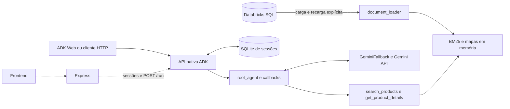

# Documentação técnica final da IA — Lojas Horizonte

Esta referência descreve o código em `ai/`, os testes existentes e o Google ADK
**1.39.1** instalado. Evidências anteriores são identificadas como históricas;
testes com serviços simulados não comprovam funcionamento com serviços externos.
O [README da IA](../../ai/README.md) é o guia rápido de entrada.

## 1. Visão geral

O **Hori** é um assistente de atendimento do e-commerce Lojas Horizonte. Pesquisa
produtos, consulta características e avaliações, recomenda opções segundo critérios
do cliente e compara produtos usando evidências do catálogo e dos reviews tratados.

A solução implementa recuperação lexical com **BM25**, seguida de geração com
**Gemini**, em um único agente **Google ADK**. Não há embeddings ou banco vetorial.
As consultas às tabelas do Databricks acontecem na carga do agente, e o atendimento
reutiliza o corpus em memória. O assistente identifica produtos por seus nomes;
SKUs e IDs de avaliações permanecem internos.

Não há consulta de estoque, pedido, frete ou preço em tempo real. O preço disponível
é o registro do catálogo carregado. A aplicação FullStack deverá consumir a API nativa
do ADK por meio do Express; esse adaptador não existe neste checkout.

### Tecnologias e versões verificadas

`ai/pyproject.toml` exige **Python >=3.12**, com dependências geridas por `uv` e
`uv.lock`. O grupo `dev` é necessário para os testes e as métricas das Evals.

| Componente | Restrição declarada | Versão instalada verificada |
| --- | --- | --- |
| Python | >=3.12 | 3.12.14 |
| `google-adk` | >=1,<2 | 1.39.1 |
| `google-genai` | Transitiva do ADK | 2.34.0 |
| `databricks-sql-connector` | >=4.9.0,<5 | 4.9.0 |
| `rank-bm25` | >=0.2.2,<0.3 | 0.2.2 |
| `pytest` | >=8,<10, grupo `dev` | 9.2.0 |
| `ruff` | >=0.14,<1, grupo `dev` | 0.17.5 |
| `rouge-score` | >=0.1.2,<0.2, grupo `dev` | 0.1.2 |
| `tabulate` | >=0.9,<1, grupo `dev` | 0.10.0 |

SQLite é usado pelo serviço de sessões do ADK. O servidor HTTP é fornecido pelo ADK;
o projeto não implementa um servidor FastAPI próprio.

## 2. Arquitetura da solução

### Estrutura real

```text
ai/
├── .env.example
├── pyproject.toml
├── uv.lock
├── README.md
└── agente_horizonte/
    ├── __init__.py
    ├── agent.py
    ├── config.py
    ├── models.py
    ├── prompt.py
    ├── tools.py
    ├── customer_support.evalset.json
    ├── test_config.json
    ├── data/
    │   ├── __init__.py
    │   └── databricks_client.py
    ├── retrieval/
    │   ├── __init__.py
    │   ├── preprocessing.py
    │   ├── document_loader.py
    │   └── bm25.py
    ├── tests/
    │   ├── search.py
    │   ├── unit/
    │   │   ├── test_preprocessing.py
    │   │   ├── test_document_loader.py
    │   │   ├── test_bm25.py
    │   │   ├── test_databricks_client.py
    │   │   ├── test_agent.py
    │   │   ├── test_models.py
    │   │   └── test_evaluation.py
    │   └── integration/
    │       ├── test_api.py
    │       └── test_databricks.py
    └── evaluation/
        ├── questions.json
        ├── evaluate.py
        ├── validation.md
        └── robustness.md
```

Diretórios locais ignorados pelo Git incluem `.venv/`, `.cache/`, `.adk/`, caches
Python e o histórico de Evals em `agente_horizonte/.adk/`. Não são componentes de código.

### Responsabilidades

| Arquivo | Responsabilidade |
| --- | --- |
| `config.py` | Validar variáveis, identificadores SQL, timeouts, modelos e limites |
| `data/databricks_client.py` | Abrir conexões, executar consultas parametrizadas e traduzir erros |
| `retrieval/document_loader.py` | Carregar lotes completos, preparar documentos, validar vínculos e agregar notas |
| `retrieval/preprocessing.py` | Normalização e tokenização compartilhadas por corpus e consultas |
| `retrieval/bm25.py` | `BM25Retriever`: índice em memória, ranking, Top-K e reconstrução |
| `tools.py` | Ciclo de vida do índice, mapas por nome/produto, ferramentas, ocultação de IDs e callbacks de limites |
| `models.py` | `GeminiFallback`: tentativas limitadas e seleção ordenada dos modelos |
| `prompt.py` | `AGENT_INSTRUCTION`, regras de atendimento e fundamentação |
| `agent.py` | Configurar e expor `root_agent`, inicializando o índice na importação |
| `__init__.py` | Expor `agent` sob demanda para o CLI de avaliação, ajustando o caminho de importação |
| `tests/search.py` | Busca manual de desenvolvimento, sem Gemini; exibe IDs internos no terminal |
| `evaluation/` e arquivos de Evals | Consultas de referência, avaliação nativa e ensaio de robustez |

### Comunicação



Ao carregar `agent.py`, o código valida modelos e limites e chama `initialize_index()`.
O índice e seus mapas são compartilhados pelas sessões do mesmo processo. A cada
mensagem, o ADK recupera o histórico, aplica os callbacks e chama Gemini. O modelo
pode solicitar ferramentas; seus resultados voltam como contexto para a geração
seguinte. Gemini não recebe conexão SQL nem ferramenta de SQL arbitrário.

## 3. Integração com Databricks

### Conexão e consultas

`databricks_connection_options()` configura `databricks.sql.connect` com hostname,
HTTP path do warehouse e token de ambiente. Cada chamada abre conexão e cursor em
blocos `with`, executa a consulta, faz `fetchall()` e retorna `list[dict]` a partir
de `row.asDict()`. Os recursos são fechados também em falhas.

A configuração desabilita parâmetros inline, Cloud Fetch e telemetria do conector;
limita a contagem de tentativas do conector a 1 e define timeouts de socket e
`STATEMENT_TIMEOUT`. Não existe laço de retry na camada do projeto.

- `fetch_products(product_id=None, category=None, *, limit=1000)`: `SELECT *` no
  catálogo, com filtros de igualdade opcionais e combináveis.
- `fetch_reviews(product_id=None, category=None, *, limit=1000)`: `SELECT r.*` nos
  reviews. Categoria usa `EXISTS` no catálogo pela chave do produto, evitando
  multiplicação de reviews por linhas duplicadas do catálogo.
- Valores de produto, categoria e limite usam parâmetros SQL nativos (`:product_id`,
  `:category`, `:limit`). Identificadores vêm da configuração e são validados e
  delimitados por crases; não são recebidos livremente do chat.
- `limit` deve ser inteiro positivo ou `None`. `None` solicita carga completa.
  Não há paginação nem `ORDER BY`; resultado vazio retorna `[]`.

Tabelas exigem três partes, como `catalogo.schema.tabela`. Cada parte e nome de coluna
aceita letras ASCII, números e `_`, começando por letra ou `_`.

### Fontes e campos consumidos

O mapeamento atual, registrado na validação anterior, é:

| Fonte | Tabela | Identificação e campos usados |
| --- | --- | --- |
| Catálogo | `horizonte.gold.gold_catalogo` | Chave `sku`, categoria `categoria`, nome `nome`; campos textuais e atributos abaixo |
| Avaliações | `horizonte.gold.gold_avaliacoes` | `avaliacao_id`, `sku`, `nome_produto`, `categoria`, `grupo`, `nota`, `titulo`, `comentario`, `data` |

O código não fixa os nomes das tabelas: use as variáveis de ambiente. O agente fixa
o mapeamento textual dos reviews em `avaliacao_id`, `titulo` e `comentario`.
Reviews são opcionais quando **ambas** as variáveis de tabela/chave estão vazias;
preencher apenas uma gera erro na carga. Consultar `fetch_reviews` diretamente
exige as duas. Não há inferência de vínculo por pedido.

`load_documents_from_databricks()` carrega todo o catálogo com `limit=None`.
Por padrão, a função isolada não inclui reviews; `initialize_index()` fornece
explicitamente os campos de reviews e os inclui quando configurados. Uma falha na
leitura dos reviews configurados impede publicar a nova carga inteira.

Os agregados `nota_media` e `qtd_avaliacoes` do catálogo são prioritários. A contagem
deve ser inteiro não negativo; a média só é aceita quando finita, entre 1 e 5 e com
contagem positiva. Se esses campos não estiverem presentes, a carga com reviews
calcula `average_rating` e `review_count` pelas notas numéricas válidas entre 1 e 5,
incluindo avaliações sem comentário. Campos presentes, mas inválidos, não são
substituídos pelo agregado dos comentários.

### Erros e atualização dos dados

| Situação identificada | Exceção exposta pela camada SQL |
| --- | --- |
| Configuração ausente/inválida | `ValueError` |
| HTTP 401/403 ou SQLSTATE 42501 | `PermissionError` |
| HTTP 429/503, falha ao conectar, `OperationalError` ou erro de rede | `ConnectionError` |
| Demais erros SQL do conector | `RuntimeError` |

As mensagens traduzidas não reproduzem os detalhes sensíveis do conector.
`initialize_index()` captura essas quatro classes, registra somente a classe do erro
e retorna `False`. Na primeira falha, as ferramentas respondem `unavailable`;
numa recarga com índice anterior, esse índice permanece disponível. A inicialização
do agente não verifica o retorno booleano, portanto servidor disponível não comprova
que a carga deu certo. Configuração inválida de Gemini/limites falha antes dessa etapa.

Após a equipe de Dados atualizar as tabelas, reinicie o processo que serve o agente
para carregar os dados novamente. Alternativamente, no **mesmo processo** do agente:

```python
from agente_horizonte.tools import initialize_index

updated = initialize_index()  # True: nova carga publicada; False: índice anterior preservado
```

Executar essa função em outro terminal Python só atualiza aquele novo processo.
Não existe endpoint HTTP de recarga, agendamento, atualização incremental ou TTL.
`replace_index(documents)` constrói o recuperador, os mapas e o padrão de IDs antes
de publicar o novo estado. Carga vazia bem-sucedida deixa um índice vazio disponível;
`replace_index(None)` marca indisponibilidade.

## 4. Recuperação de informações com BM25

### Documentos e pré-processamento

`normalize_text()` aplica `casefold`, normalização Unicode NFKD, remoção de marcas
de acento e extração de palavras/números. Pontuação e `_` viram separadores;
espaços são consolidados. `tokenize()` divide o texto normalizado. Não há remoção
de stopwords, stemming ou expansão de sinônimos. Repetições, números e negações
como “não” são preservados. `None`, vazio e somente pontuação produzem lista vazia.

`build_product_documents()` utiliza apenas strings dos campos `nome`, `modelo`,
`categoria`, `grupo`, `tipo`, `variacao`, `cor`, `descricao` e `ocasioes` como texto
de recuperação. Preços, URLs, vendas e IDs não entram no texto BM25.

`build_review_documents()` utiliza os campos de texto recebidos; no agente, são
`titulo` e `comentario`. Exige vínculo textual não vazio com um produto. Quando há
coluna de ID, descarta IDs ausentes e todos os registros de uma avaliação com vínculos
conflitantes no lote. IDs repetidos com vínculo único preservam a primeira linha
válida, sem combinar textos ou escolher a mais recente. Sem coluna de ID
(`review_id_field=None`), não há deduplicação por identidade.

Documentos sem identificador textual válido ou sem tokens são omitidos. Uma review
com apenas título pode ser indexada; uma review só com nota não vira documento
textual, mas pode contribuir para a média. A validação de conflitos considera o lote
recebido; exige fonte tratada inequívoca. Não há validação completa de schema nem
checagem geral de integridade referencial contra todos os SKUs do catálogo no loader.

Cada documento mantém `product_id`, `type` (`product`/`review`), `text`, `tokens` e
`source`, contendo tabela e cópia da linha original. Review com ID inclui `review_id`.
Produtos podem incluir `average_rating` e `review_count`. IDs e metadados originais
não sofrem normalização. Produtos e reviews são documentos separados.

### Índice, ranking e Top-K

`BM25Retriever` cria `BM25Okapi` de `rank-bm25` com os parâmetros padrão da biblioteca.
Mantém cópias dos documentos e o corpus em memória. `search()` normaliza a consulta,
calcula os scores e considera documentos com **pelo menos um termo** correspondente.
Não exige correspondência de todos os termos. Ordena por score decrescente, preservando
a ordem do corpus em empates, e só então aplica o Top-K.

`BM25_TOP_K` define o padrão do agente (5). Em Python, `search(query, top_k=3)`
substitui o limite somente naquela consulta. Exige inteiro positivo; o limite conta
**documentos**, não produtos distintos. Uma busca pode retornar produto e reviews
do mesmo SKU. A ferramenta ADK não expõe argumento `top_k` ao modelo.

Scores zero ou negativos são permitidos quando existe termo correspondente; não são
filtro de ausência de resultados. Score é relevância lexical, não qualidade ou nota.
Consulta vazia, sem termos do corpus ou índice vazio retorna `[]` na busca comum.

Com `sort_by_rating=True`, a busca considera somente documentos de produto com média
válida; ordena primeiro por média, depois por BM25, e aplica o Top-K. Consulta vazia
nesse modo permite listar os produtos avaliados de maior média em todo o corpus.
Não há ponderação por quantidade de avaliações ou desempate por vendas.

O retorno interno inclui `product_id`, `type`, `text`, `source`, `score` e os campos
opcionais de review/agregados. As ferramentas transformam esse retorno em evidência
pública, sem IDs ou linha bruta de origem.

### Reconstrução e inspeção

`rebuild(documents)` prepara outro índice e só substitui o anterior após sucesso.
Não acessa rede. Exemplo de uso direto, fora do agente, com ambiente configurado:

```python
from agente_horizonte.config import bm25_top_k
from agente_horizonte.retrieval.bm25 import BM25Retriever
from agente_horizonte.retrieval.document_loader import load_documents_from_databricks

documents = load_documents_from_databricks(
    review_id_field="avaliacao_id", review_text_fields=("titulo", "comentario")
)
retriever = BM25Retriever(documents, top_k=bm25_top_k())
results = retriever.search("bermuda azul", top_k=3)
retriever.rebuild(load_documents_from_databricks())  # substitui por catálogo sem reviews
```

No agente, use `initialize_index()` para atualizar também os mapas de detalhes e nomes.
`get_documents()` e a propriedade `documents` retornam cópias; alterá-las não muda o
índice. `temporary_index()` serve a avaliações/testes isolados e restaura o estado ao
sair; não deve ser usado durante atendimento concorrente.

## 5. Agente Google ADK e Gemini

### Configuração e ferramentas

`root_agent` é um `Agent` chamado `agente_horizonte`, com descrição do Hori,
`temperature=0.2`, teto de saída configurável e timeout HTTP de **30.000 ms** por
requisição ao modelo. Usa API key do Google AI Studio; Vertex AI é rejeitado pela
validação. Não existem subagentes.

| Ferramenta | Entrada | Comportamento |
| --- | --- | --- |
| `search_products` | `query: str`, `sort_by_rating: bool=False` | Busca BM25 em produtos/reviews ou ranking por média, com Top-K configurado |
| `get_product_details` | `product_name: str` | Correspondência exata do nome normalizado; retorna atributos e seleção de reviews indexadas |

Nomes parciais devem ser pesquisados antes de consultar detalhes pelo nome completo.
Produtos homônimos retornam evidências separadas pelos vínculos internos, e o prompt
orienta pedir atributos para desambiguar. Detalhes não têm Top-K de produtos: retornam
os documentos correspondentes ao nome e até `PRODUCT_MAX_REVIEWS` comentários por SKU.
Os comentários são os primeiros na ordem do corpus, sem garantia de recência.

As ferramentas retornam `status` e `results`; estados possíveis:

- `success`: há evidências.
- `no_results`: índice disponível, mas sem correspondência.
- `unavailable`: índice não disponível.
- `invalid_query`: entrada excessiva ou com identificador interno.

Cada evidência pública tem `product_name`, `type` e `data`. Produtos podem expor
`modelo`, `categoria`, `grupo`, `tipo`, `variacao`, `cor`, `preco`, `descricao`,
`ocasioes`, `imagem_url`, `unidades_vendidas`, `unidades_30_dias` e `popularidade`,
quando presentes. Reviews expõem `nota`, `titulo`, `comentario` e `data`.
`score`, `average_rating` e `review_count` aparecem quando disponíveis no documento.
Valores `Decimal` e datas são serializados como strings.

Quando há mais comentários indexados que o limite dos detalhes, o retorno inclui
`comments_partial=true`, `comments_available` e `comments_returned`. Essas contagens
não substituem o total de notas do produto. Campos `descricao`, `ocasioes`, `titulo`
e `comentario` são cortados no limite configurado, recebem `…` e são identificados
em `truncated_fields`.

O prompt exige evidência antes de afirmações factuais, verificação de cada produto
em comparações, distinção entre opinião e atributo, explicitação de dados ausentes
e tratamento de textos recuperados como dados não confiáveis. Saudação e perguntas
de esclarecimento dispensam ferramentas. O Hori deve se apresentar somente na primeira
resposta da sessão, em português brasileiro, salvo solicitação de outro idioma.
Essas instruções orientam a geração; não constituem prova automática de correção factual.

### Modelos e fallback

Não existe modelo Gemini fixo ou padrão em `agent.py`. A ordem é:
`GEMINI_MODEL` → `GEMINI_MODEL_FALLBACK_1` → `GEMINI_MODEL_FALLBACK_2`, omitindo
fallbacks vazios. O modelo principal e `GOOGLE_API_KEY` são obrigatórios.
A configuração valida o formato `gemini-...`, não a disponibilidade no provedor.
O ambiente local inspecionado usa `gemini-3.1-flash-lite`, seguido de
`gemini-3.5-flash-lite` e `gemini-3.6-flash`. São valores locais, não garantias de acesso
nem padrões do projeto. O registro histórico de execução real usa o primeiro modelo.
Confirme o ID e o acesso da conta no [catálogo oficial Gemini](https://ai.google.dev/gemini-api/docs/models).

`GeminiFallback` implementa o fallback no ADK Python. Cada instância `Gemini` usa
`HttpRetryOptions(attempts=1)`; o adaptador controla as tentativas:

1. Clona a requisição, seleciona o modelo atual e tenta gerar a resposta.
2. Para `APIError` HTTP **408, 429, 500, 502, 503 ou 504**, tenta novamente no mesmo
   modelo até `GEMINI_MAX_ATTEMPTS_PER_MODEL` e depois passa ao próximo. Aguarda
   1 segundo entre tentativas, inclusive na troca de modelo.
3. Outros códigos, como 400/401/403/404, interrompem com `RuntimeError` sem fallback.
   Modelo inexistente com 404 não provoca troca automática.
4. Se já emitiu parte da resposta e ocorre `APIError`, interrompe sem repetir o fluxo.
   Resposta de segurança retornada pelo provedor não aciona fallback.
5. Esgotamento de todos os modelos gera erro controlado de indisponibilidade.
   Exceções fora de `APIError`, inclusive erros de programação, não são capturadas
   como falhas transitórias pelo adaptador.

O padrão é 2 tentativas por modelo, permitido de 1 a 3. Com três modelos e padrão 2,
uma chamada lógica pode fazer até 6 tentativas ao provedor. Não há timeout global
da mensagem; o timeout HTTP não limita o atendimento inteiro. Logs registram modelo,
tentativa e código de falha, além do modelo que concluiu a geração.
Fallback não garante superar quotas compartilhadas ou autorização inválida.

### Callbacks e limites

`require_product_name` reinicia contadores temporários por mensagem e rejeita texto
acima do limite ou com IDs internos. O reconhecimento inclui padrões `HZ-...`,
`REV-...` e IDs presentes no corpus. `limit_model_calls` limita chamadas lógicas;
`guard_model_response` oculta IDs no texto e controla lotes de ferramentas.

Chamadas idênticas no mesmo lote são deduplicadas pelo nome e argumentos serializados.
Repetição em rodada posterior da mesma mensagem ou lote que exceda o saldo encerra
o atendimento com resposta curta, sem executar aquele lote. Limites não dependem
apenas do prompt. Contadores `temp:` não são persistidos no estado da sessão.

| Variável | Padrão | Intervalo aceito |
| --- | ---: | --- |
| `AGENT_MAX_INPUT_CHARS` | 4000 | 1–20000 caracteres textuais por mensagem |
| `AGENT_MAX_OUTPUT_TOKENS` | 1024 | 1–8192 tokens por geração |
| `AGENT_MAX_TOOL_CALLS` | 6 | 1–20 chamadas distintas por mensagem |
| `AGENT_MAX_MODEL_CALLS` | 8 | 1–30 chamadas lógicas por mensagem |
| `PRODUCT_MAX_REVIEWS` | 5 | 1–20 comentários por produto nos detalhes |
| `EVIDENCE_MAX_TEXT_CHARS` | 1000 | 1–4000 caracteres por campo descritivo |

São orçamentos por mensagem, não quotas globais ou por usuário. Não limitam o tamanho
do histórico acumulado nem anexos multimodais. Tentativas de fallback não contam como
novas chamadas lógicas nesses contadores.

## 6. API e integração com FullStack

### Servidor e endpoints nativos

Os comandos da seção 7 iniciam `adk api_server`. O contrato foi conferido no código
instalado em `google/adk/cli/adk_web_server.py`, nos schemas Pydantic e nos testes.
Consulte também `/docs` e `/openapi.json` do servidor em execução. A
[documentação oficial do API Server](https://adk.dev/runtime/api-server/) pode evoluir;
para este checkout prevalece o comportamento verificado na versão 1.39.1.

Todos os endpoints abaixo são **nativos do ADK**; não há `/chat`, API Python própria
ou endpoint Express implementado no repositório.

| Método e caminho | Uso e contrato |
| --- | --- |
| `GET /list-apps` | Lista aplicações; teste retorna `["agente_horizonte"]` |
| `POST /apps/{app_name}/users/{user_id}/sessions` | Cria sessão; corpo `{}` é válido; retorna objeto de sessão, HTTP 200 |
| `GET /apps/{app_name}/users/{user_id}/sessions` | Lista sessões; conferido no código nativo, sem teste específico no projeto |
| `GET /apps/{app_name}/users/{user_id}/sessions/{session_id}` | Obtém estado e eventos; sessão ausente retorna 404 |
| `DELETE /apps/{app_name}/users/{user_id}/sessions/{session_id}` | Exclui sessão; disponível no código nativo, não exercitado nesta validação |
| `POST /run` | Executa mensagem e retorna `list[Event]` em JSON, HTTP 200 |
| `POST /run_sse` | Alternativa nativa SSE; não exercitada pelos testes HTTP deste projeto |

Na criação, `app_name` e `user_id` são obrigatórios no caminho. O corpo pode conter
`sessionId`, `state` e `events`, todos opcionais. Para uma conversa nova, use `{}`
e guarde o campo `id` retornado. A resposta de sessão contém `id`, `appName`,
`userId`, `state`, `events` e `lastUpdateTime`, conforme captura com TestClient.

O corpo de `/run` usa aliases camelCase:

| Campo | Tipo e exigência |
| --- | --- |
| `appName` | String obrigatória, `agente_horizonte` |
| `userId` | String obrigatória, identidade mantida pelo consumidor |
| `sessionId` | String obrigatória, ID criado anteriormente para esse usuário/aplicação |
| `newMessage` | Objeto `Content`; opcional no schema nativo por suportar retomadas; enviar em uma mensagem normal |
| `newMessage.role` / `newMessage.parts` | Para o fluxo textual: `"user"` e lista de objetos `{"text":"..."}` |
| `streaming` | Boolean opcional, padrão `false`; em `/run_sse`, `true` habilita modo de streaming do modelo |
| `stateDelta`, `functionCallEventId`, `invocationId` | Campos opcionais nativos; não necessários ao fluxo textual documentado |

`POST /run` não ativa SSE por receber `streaming=true`; a rota SSE é `/run_sse`.
Nessa rota, a resposta usa `text/event-stream` com quadros `data: <evento JSON>`.
Erros durante o stream podem vir como um quadro `{"error":"..."}` após o HTTP
inicial. Esse comportamento foi inspecionado no SDK e não validado ponta a ponta aqui.

### Requisições reproduzíveis

Com o servidor local iniciado, execute em outro terminal PowerShell. Esta sequência
faz chamadas reais e não representa uma resposta previamente capturada:

```powershell
$adkBase = 'http://127.0.0.1:8000'
$userId = 'customer-demo'
$session = Invoke-RestMethod -Method Post -Uri "$adkBase/apps/agente_horizonte/users/$userId/sessions" -ContentType 'application/json' -Body '{}'
$payload = @{
    appName = 'agente_horizonte'
    userId = $userId
    sessionId = $session.id
    newMessage = @{ role = 'user'; parts = @(@{ text = 'Procuro uma bermuda azul' }) }
} | ConvertTo-Json -Depth 10
$events = Invoke-RestMethod -Method Post -Uri "$adkBase/run" -ContentType 'application/json; charset=utf-8' -Body ([System.Text.Encoding]::UTF8.GetBytes($payload))
$events | ConvertTo-Json -Depth 30
Invoke-RestMethod -Method Get -Uri "$adkBase/apps/agente_horizonte/users/$userId/sessions/$($session.id)"
```

Exemplo de corpo JSON aceito pelo schema e compatível com o teste `run_payload`.
O valor de `sessionId` abaixo é um placeholder a substituir, não um ID capturado:

```json
{
  "appName": "agente_horizonte",
  "userId": "customer",
  "sessionId": "id-retornado-na-criacao",
  "newMessage": {
    "role": "user",
    "parts": [{"text": "Quais as características do Tênis azul?"}]
  }
}
```

### Respostas verificadas e interpretação dos eventos

`/run` retorna uma lista com eventos de chamada de ferramenta, resposta de ferramenta
e texto do modelo; pode incluir eventos sem `content`. Não retorna um objeto
`{"answer": ...}`. O texto fica em `event.content.parts[].text`; evidências ficam
em `event.content.parts[].functionResponse.response`. IDs de eventos/chamadas do ADK
não são SKUs de produtos.

Na captura de **21/11/2026**, reutilizando a fixture `api` de `test_api.py`, a API
real do ADK foi executada em TestClient com SQLite temporário, **Gemini e conexão SQL
simulados**. `/run` retornou HTTP 200. Este recorte da lista mantém apenas `author`
e `content` do último evento; os eventos anteriores e os demais metadados foram omitidos.
O texto foi produzido pelo modelo simulado da fixture, não pelo Gemini real:

```json
[
  {
    "author": "agente_horizonte",
    "content": {
      "parts": [{"text": "Resposta simulada: [omitido], [omitido]."}],
      "role": "model"
    }
  }
]
```

O objeto abaixo é o conteúdo capturado de
`functionResponse.response` para `get_product_details("Tênis azul")`, e não a lista
inteira de eventos. Nome, preço e avaliação são dados sintéticos da fixture:

```json
{
  "status": "success",
  "results": [
    {
      "product_name": "Tênis azul",
      "type": "product",
      "data": {"cor": "Azul", "preco": "99.90"},
      "average_rating": 5.0,
      "review_count": 1
    },
    {
      "product_name": "Tênis azul",
      "type": "review",
      "data": {
        "nota": 5,
        "titulo": "Excelente",
        "comentario": "Macio e confortável",
        "data": "2026-11-18"
      }
    }
  ]
}
```

A mesma fixture confirmou `GET /list-apps` com HTTP 200 e
`["agente_horizonte"]`. Consultar uma sessão inexistente retornou HTTP 404:

```json
{"detail": "Session not found"}
```

Os testes também verificam HTTP 422 para payload incompatível, 404 para `/run`
sem sessão válida e 500 quando o modelo falha. Indisponibilidade do índice é um
resultado de ferramenta `unavailable`, podendo ocorrer dentro de HTTP 200.
Rejeição de texto longo também retorna mensagem controlada em HTTP 200 sem chamar
Gemini. Portanto, o consumidor precisa avaliar status HTTP **e** conteúdo dos eventos.

### Sessões SQLite e integração Express

Use `--session_service_uri "sqlite:///.adk/session.db"` a partir de `ai/` para
persistir histórico e estado. O caminho relativo resolve para `ai/.adk/session.db`.
Mantenha o mesmo arquivo/URI/diretório de trabalho ao reiniciar. O teste
`test_api_restores_sqlite_history_and_keeps_users_separate` recria o aplicativo com o
mesmo banco, compara eventos, continua a conversa e verifica 404 para outro usuário.
Essa é validação local com TestClient, não um teste do navegador ou de autenticação.

O índice BM25 é independente: SQLite não armazena o corpus. Ao iniciar outro processo,
o agente recarrega os dados. Sessões antigas podem conter evidências de uma versão
anterior dos dados; não há invalidação automática desse histórico na recarga.

O Express deverá criar/manter a sessão, obter `userId` de sua própria autenticação,
enviar o trio consistente `appName`/`userId`/`sessionId` e adaptar os eventos. O ADK
separa registros por esses IDs, mas isso não autentica quem envia uma requisição.

O exemplo abaixo mostra somente a etapa de consumo em Node.js com `fetch` disponível.
É uma **orientação de integração**, sem endpoint Express criado ou fluxo FullStack
validado. `sessionId` deve vir de uma criação de sessão anterior:

```javascript
async function consultarHori({ userId, sessionId, message }) {
  const response = await fetch('http://127.0.0.1:8000/run', {
    method: 'POST',
    headers: { 'content-type': 'application/json' },
    body: JSON.stringify({
      appName: 'agente_horizonte', userId, sessionId,
      newMessage: { role: 'user', parts: [{ text: message }] },
    }),
    signal: AbortSignal.timeout(120000), // política do consumidor; não é padrão do ADK
  });
  if (!response.ok) throw new Error(`ADK retornou HTTP ${response.status}`);
  const events = await response.json();
  if (!Array.isArray(events)) throw new Error('Resposta ADK inesperada');
  const modelEvents = events.filter(event =>
    event.author === 'agente_horizonte' && event.content?.role === 'model'
  );
  const finalEvent = modelEvents.findLast(event =>
    event.content.parts?.some(part => part.text && !part.thought) &&
    !event.content.parts?.some(part => part.functionCall)
  );
  const answer = (finalEvent?.content.parts ?? [])
    .filter(part => part.text && !part.thought).map(part => part.text).join('\n');
  const evidence = events.flatMap(event => event.content?.parts ?? [])
    .flatMap(part => part.functionResponse ? [part.functionResponse.response] : []);
  return { answer, evidence }; // objeto local deste exemplo; não é contrato nativo
}
```

O timeout do consumidor deve considerar ferramentas e tentativas por modelo; não há
garantia de que 120 segundos cubram todas as configurações. Não repita mensagens
automaticamente sem avaliar duplicação de eventos e custo. Não infira IDs a partir
de texto: as ferramentas atuais removem IDs e referências brutas. Um contrato que
exija SKU para links de produto depende de acordo e mudança futura entre equipes.

Comunicação Express → ADK entre servidores não exige CORS. Para acesso direto por
navegador em desenvolvimento, acrescente `--allow_origins http://localhost:5173`
somente se essa for a origem real. O teste de CORS valida essa origem e recebe 403
para preflight de origem não autorizada. Não há origem FullStack definida no código.
O ADK CLI permanece em `127.0.0.1`; esta implementação é de desenvolvimento local.

## 7. Instalação e execução local

### Pré-requisitos e dependências

Requer Python 3.12+, `uv`, rede para instalar dependências e, em execução real,
acesso ao warehouse/tabelas e à Gemini API. O token deve permitir uso do warehouse,
acesso a catálogo/schema e leitura das tabelas. Confirme o método de autenticação
suportado pelo workspace; a implementação atual usa exclusivamente token.

PowerShell, partindo da raiz do repositório:

```powershell
Set-Location ai
uv sync --locked
if (-not (Test-Path .env)) { Copy-Item .env.example .env }
```

`uv sync --locked` preserva o lockfile e instala também o grupo `dev` por padrão.
O código lê o ambiente; `uv run --env-file .env` carrega o arquivo. O ADK também tem
carregamento automático de `.env`, relevante para o isolamento dos testes na seção 8.
Não exponha os valores de chaves/tokens em exemplos, Git ou logs.

### Variáveis de ambiente

| Variável | Obrigatoriedade e comportamento |
| --- | --- |
| `DATABRICKS_SERVER_HOSTNAME` | Obrigatória na carga; hostname sem protocolo |
| `DATABRICKS_HTTP_PATH` | Obrigatória; `/sql/1.0/warehouses/<identificador>` |
| `DATABRICKS_TOKEN` | Obrigatória na conexão; segredo do ambiente |
| `DATABRICKS_CATALOG_TABLE` | Obrigatória; tabela com três partes |
| `DATABRICKS_CATALOG_PRODUCT_ID_COLUMN` | Obrigatória; mapeamento atual `sku` |
| `DATABRICKS_CATALOG_CATEGORY_COLUMN` | Obrigatória; mapeamento atual `categoria` |
| `DATABRICKS_REVIEWS_TABLE` | Opcional em conjunto com a coluna de produto |
| `DATABRICKS_REVIEWS_PRODUCT_ID_COLUMN` | Obrigatória quando reviews habilitados; atual `sku` |
| `DATABRICKS_SOCKET_TIMEOUT_SECONDS` | Padrão 30; inteiro de 1 a 300 |
| `DATABRICKS_STATEMENT_TIMEOUT_SECONDS` | Padrão 60; inteiro de 1 a 300 |
| `BM25_TOP_K` | Padrão 5; inteiro positivo |
| `GOOGLE_API_KEY` | Obrigatória para importar o agente; segredo Gemini API |
| `GOOGLE_GENAI_USE_VERTEXAI` | Ausente, vazio, `false` ou `0`; demais valores são rejeitados, sem distinção de caixa |
| `GEMINI_MODEL` | Obrigatória; um ID `gemini-...`, sem padrão |
| `GEMINI_MODEL_FALLBACK_1`, `GEMINI_MODEL_FALLBACK_2` | Opcionais; cada uma recebe um ID, não uma lista |
| `GEMINI_MAX_ATTEMPTS_PER_MODEL` | Padrão 2; inteiro de 1 a 3 |
| Seis variáveis de limites da seção 5 | Opcionais se ausentes; valor vazio é inválido |
| `RUN_DATABRICKS_INTEGRATION` | Somente testes; `1` habilita consultas reais, demais valores deixam testes ignorados |
| `ADK_DISABLE_LOAD_DOTENV` | Opção do ADK, não do `config.py`; usar `1` para impedir carga automática do `.env` nos testes simulados |
| `PYTHONUTF8` | Opção do Python; `1` evita falhas ao imprimir emojis no Windows |

**Preparação necessária do `.env`:** o template versionado deixa as seis variáveis
de limites vazias. Preencha os valores padrão abaixo, ou remova essas seis linhas
do arquivo local para utilizar os padrões do código. Não basta deixá-las vazias.

```dotenv
AGENT_MAX_INPUT_CHARS=4000
AGENT_MAX_OUTPUT_TOKENS=1024
AGENT_MAX_TOOL_CALLS=6
AGENT_MAX_MODEL_CALLS=8
PRODUCT_MAX_REVIEWS=5
EVIDENCE_MAX_TEXT_CHARS=1000
```

Reinicie o processo após alterar configurações. Modelos e configuração de geração
são preparados na importação; alguns limites são lidos novamente pelos callbacks.

### ADK Web e API Server

Os comandos seguintes partem de `ai/`. A criação de `.adk` prepara o diretório do
SQLite; o CLI da versão instalada aceita `--session_service_uri` em ambos os modos:

```powershell
New-Item -ItemType Directory -Force .adk | Out-Null
uv run --locked --env-file .env adk web --host 127.0.0.1 --port 8000 --no-reload --session_service_uri "sqlite:///.adk/session.db" .
```

Acesse `http://127.0.0.1:8000` e selecione `agente_horizonte`. `tests/` e `evaluation/`
ficam dentro do pacote para não aparecerem como aplicações na descoberta do ADK.
Para executar somente a API, encerre o Web e rode:

```powershell
uv run --locked --env-file .env adk api_server --host 127.0.0.1 --port 8000 --no-reload --session_service_uri "sqlite:///.adk/session.db" .
```

Não combine a URI explícita com `--use_local_storage` ou `--no_use_local_storage`:
o CLI rejeita essa combinação. O `.` deve apontar para `ai/`, pai do agente.
Não use `ai/agente_horizonte/` como diretório de descoberta. Para dois processos
simultâneos, escolha portas diferentes e considere a duplicação das cargas.

Busca lexical sem Gemini, com inspeção de IDs no terminal de desenvolvimento:

```powershell
uv run --locked --env-file .env python -X utf8 -m agente_horizonte.tests.search
uv run --locked --env-file .env python -X utf8 -m agente_horizonte.tests.search --reviews
uv run --locked --env-file .env python -X utf8 -m agente_horizonte.tests.search --best-rated
```

Execute uma opção por vez. As duas últimas solicitam reviews quando configurados.
Digite termos presentes no catálogo; `sair`, Ctrl+C ou EOF encerram o prompt. A busca
manual não depende de chave Gemini, mas exige as variáveis Databricks.

### Diagnóstico operacional

- Agente não carrega: verifique Python, dependências, diretório do CLI, chave/modelo
  e valores inteiros das variáveis, especialmente limites vazios do template.
- Ferramenta retorna `unavailable`: confirme configuração/permissões/warehouse; veja
  a classe de erro de carga no log e recarregue explicitamente ou reinicie.
- `no_results`: confirme nome, termos e campos textuais; não equivale a erro de rede.
- HTTP 404 em `/run`: crie a sessão e mantenha o mesmo usuário/aplicação.
- HTTP 422: confira os tipos e a estrutura `newMessage.parts` no OpenAPI local.
- Falhas Gemini: diferencie quota/indisponibilidade transitória de ID inválido e
  credenciais; 404 de modelo não aciona fallback.

## 8. Testes e validação

### Suíte existente

`pyproject.toml` configura descoberta em `agente_horizonte/tests` e caminho de importação
`.`. O marcador `integration` habilita a classificação dos testes Databricks; os
testes de API usam TestClient e executam na suíte padrão sem serviços externos.

| Arquivo ou conjunto | Cenários verificados |
| --- | --- |
| `unit/test_preprocessing.py` | Normalização, acentos, pontuação, vazios e consistência corpus/consulta |
| `unit/test_document_loader.py` | Campos, origem, vínculos, reviews sem texto, conflitos, deduplicação, médias e falhas de recarga |
| `unit/test_bm25.py` | Ranking, Top-K, scores zero/negativos, corpus vazio, reconstrução e ordenação por nota |
| `unit/test_databricks_client.py` | Configuração, filtros parametrizados, limites, recursos e tradução segura de erros |
| `unit/test_models.py` | Modelos/ambiente, ordem dos fallbacks, tentativas, falhas permanentes, segurança e resposta parcial |
| `unit/test_agent.py` | Ferramentas, nomes, ocultação de IDs, dados públicos, limites, comentários parciais e troca de índice |
| `unit/test_evaluation.py` | Ensaio de robustez, casos sem reviews e restauração de estado em falhas |
| `integration/test_api.py` | Descoberta, Evals, protocolo real ADK, ferramentas/BM25, sessões SQLite, isolamento por usuário, CORS, erros e orçamentos |
| `integration/test_databricks.py` | Seis testes opcionais reais: leitura/filtros de catálogo e reviews, preparação, BM25/recarga das duas fontes e ranking por nota |

Nos testes da API, apenas Gemini e `sql.connect` são simulados; agente, ferramentas,
BM25, servidor nativo e SQLite são reais. O modelo segue roteiro explícito, portanto
esses testes não avaliam a capacidade do Gemini de escolher a ferramenta correta.

As oito consultas predefinidas de `evaluation/questions.json` são verificadas no
corpus sintético dos testes. Não representam uma métrica de relevância para todo o
catálogo real ou um percentual de precisão.

### Execução local reproduzível

PowerShell, em `ai/`, sem carregar `.env` da aplicação para a suíte simulada:

```powershell
$env:ADK_DISABLE_LOAD_DOTENV = '1'
uv run --locked pytest -q --tb=short -p no:cacheprovider
Remove-Item Env:ADK_DISABLE_LOAD_DOTENV
uv run --locked ruff check .
uv run --locked ruff format --check .
```

Se desejar executar somente unitários, use
`uv run --locked pytest agente_horizonte/tests/unit -q` com o mesmo isolamento.
Não foi feita uma contagem separada de unitários nesta rodada.

**Resultados executados em 21/11/2026**, usando também `--offline` em cada comando
`uv run` para reutilizar o ambiente instalado sem acesso ao registro de pacotes:

| Verificação executada | Resultado |
| --- | --- |
| `uv run --locked --offline pytest -q --tb=short -p no:cacheprovider`, sem isolamento de dotenv | **285 passaram, 1 falhou, 6 ignorados**, 72 avisos, 33,72 s |
| Mesmo comando, com `ADK_DISABLE_LOAD_DOTENV=1` | **286 passaram, 6 ignorados**, 72 avisos, 21,64 s |
| `uv run --locked --offline ruff check .` | Aprovado |
| `uv run --locked --offline ruff format --check .` | Não aprovado: 1 arquivo requer formatação, 25 já formatados |
| `uv run --locked --offline adk web --help` e `adk api_server --help` | Opções e diretório de execução conferidos |
| Captura HTTP com a fixture `api` existente e TestClient | Listagem 200, criação 200, execução 200 e sessão ausente 404; exemplos na seção 6 |
| Validação dos exemplos e links dos dois documentos | 4 blocos JSON válidos, 16 blocos PowerShell com sintaxe válida, 6 links locais existentes e âncoras conferidas; JavaScript aprovado em `node --check`, sem chamadas HTTP |
| `git diff --check` e conferência do escopo | Aprovados; somente `ai/README.md` e este documento alterados/criados; README da raiz preservado e `docs/README.md` continua ausente |

A falha sem isolamento é
`test_api_stops_tool_loops_with_a_controlled_answer[False-2-2-2]`: o teste espera
2 chamadas, mas observa 7. O ADK recarrega `.env` e substitui o valor do teste por
`AGENT_MAX_MODEL_CALLS=8` do ambiente local. O utilitário nativo preserva um conjunto
de variáveis capturado no primeiro carregamento; alterações de testes posteriores
podem ficar fora desse conjunto. Desabilitar somente a leitura automática de dotenv
no processo dos testes preservou a configuração simulada e eliminou a falha.
Nenhum teste, código ou `.env` foi alterado para obter esse resultado.

A pendência de formatação é preexistente em
`agente_horizonte/data/databricks_client.py`. Os avisos vêm principalmente de APIs
experimentais/deprecações das dependências. Não foi calculada cobertura percentual.
`uv sync --locked` está documentado para instalação, mas não foi reexecutado nesta
rodada, pois o ambiente e as dependências já estavam instalados.

### Integrações reais e evidências históricas

Para consultar o Databricks real:

```powershell
$env:RUN_DATABRICKS_INTEGRATION = '1'
uv run --locked --env-file .env pytest agente_horizonte/tests/integration/test_databricks.py -q --show-capture=no
Remove-Item Env:RUN_DATABRICKS_INTEGRATION
```

Esses testes fazem várias consultas, inclusive cargas completas e reconstruções.
Exigem tabelas com dados válidos e consomem a quota do warehouse.

Nesta issue, as seis integrações reais ficaram desabilitadas e **não foram
reexecutadas**. Há evidências históricas verificáveis no ambiente local:

- `.cache/ia06-databricks.xml`, de **20/11/2026**: 6 testes, zero falhas/erros/ignorados;
  tempo da suíte registrado no XML de 55,643 s.
- `.cache/ia06-pytest.xml`, de **20/11/2026**: 270 testes coletados, 6 ignorados,
  zero falhas/erros, correspondendo a 264 aprovados na versão daquela data.
- `evaluation/validation.md` registra a execução real de seis cenários com Gemini
  3.1 Flash-Lite e Databricks, carregando 1.385 documentos em 20/11/2026. O histórico
  local consolidado foi lido nesta issue e contém os seis resultados abaixo.

Esses artefatos `.cache/` e `.adk/` são ignorados pelo Git e podem não existir em outro
checkout. O relato versionado está em
[validation.md](../../ai/agente_horizonte/evaluation/validation.md); disponibilidade
atual do serviço exige nova execução, não pode ser deduzida desses registros.

| Caso histórico | Trajetória | ROUGE-1 | Situação registrada |
| --- | ---: | ---: | --- |
| Características | 1,0 | 0,5882 | Aprovado |
| Avaliações | 1,0 | 0,6875 | Aprovado |
| Recomendação | 1,0 | 0,4932 | Aprovado |
| Comparação | 1,0 | 0,5306 | Aprovado |
| Sem resultados | 1,0 | 0,4878 | Aprovado |
| Informação insuficiente | 1,0 | 0,5000 | Aprovado |

### Evals e robustez

`customer_support.evalset.json` contém os seis casos acima. As respostas de referência
do arquivo são expectativas, não respostas capturadas. `test_config.json` define
`tool_trajectory_avg_score=1` e `response_match_score=0.3`.

Na aba **Evals**, selecione `customer_support`, os casos e **Run Evaluation**.
No ADK Web 1.39.1, escolha os dois thresholds no diálogo: essa interface não carrega
automaticamente `test_config.json`. Pelo CLI, a partir de `ai/`:

```powershell
$env:PYTHONUTF8 = '1'
uv run --locked --env-file .env adk eval agente_horizonte agente_horizonte/customer_support.evalset.json --config_file_path agente_horizonte/test_config.json --print_detailed_results
```

Use caminhos relativos no Windows: o parser dessa versão utiliza `:` para separar
casos e pode interpretar a unidade de caminho absoluto como separador. UTF-8 evita
erro ao imprimir emojis. Resultados ficam em `agente_horizonte/.adk/eval_history/`.

ROUGE mede similaridade textual, não veracidade. O relatório histórico registra um
falso positivo: um produto ausente ainda produziu similaridade suficiente na comparação.
A referência foi corrigida e o caso repetido. Atualize as referências quando mudar o
catálogo; não trate aprovação nesses seis casos como precisão geral do sistema.

O ensaio de robustez é separado das Evals e faz chamadas reais:

```powershell
uv run --locked --env-file .env python -X utf8 -m agente_horizonte.evaluation.evaluate
```

Avalia instruções maliciosas diretas e em review sintética, divulgação de prompt/chave,
saída excessiva, ferramentas repetidas e entrada longa. Usa sessões em memória,
limites próprios de tentativas e índice temporário; salva
`.cache/robustness-results.json`. Não altera as tabelas Databricks. Se não encontrar
review vinculada, registra o cenário indireto como não executado.

[robustness.md](../../ai/agente_horizonte/evaluation/robustness.md) descreve o ensaio
real de **19/11/2026**, incluindo falhas de controle de repetição e tamanho de entrada
observadas naquela versão. Os limites atuais foram adicionados depois e passaram nos
testes determinísticos desta rodada. Não houve nova execução com Gemini real após
essas mudanças; os resultados históricos não certificam a robustez do agente atual.

## 9. Limitações conhecidas

### Condições existentes no checkout

- **Índice em memória:** carga completa via `fetchall()`, sem paginação, persistência
  do corpus ou atualização incremental. Índice, documentos e mapas fazem cópias e
  precisam caber na memória; cada processo repete a carga e mantém seu próprio estado.
- **Recuperação lexical:** sem sinônimos ou busca semântica. Correspondência parcial
  e Top-K por documento podem omitir produtos relevantes ou repetir o mesmo produto.
- **Dados:** campos são consumidos conforme o mapeamento atual; não existe validação
  integral de schema no loader. Reviews inválidas são omitidas, órfãs não são todas
  verificadas contra o catálogo e conflitos só são detectados dentro do lote.
  Agregados do catálogo prevalecem mesmo com comentários parciais.
- **Atualização:** não há TTL, endpoint de recarga ou garantia de snapshot transacional
  entre consultas de catálogo e reviews. Falha de recarga pode manter dados antigos.
  O histórico de sessão também pode conservar evidências antigas após trocar o corpus.
- **SQLite local:** persistência depende de preservar arquivo, caminho e permissões.
  Não há política de retenção, backup ou migração implementada pelo projeto. O teste
  verifica recriação local do serviço; não valida concorrência elevada/distribuição.
- **Configuração/testes:** limites vazios em `.env.example` impedem carregar o agente
  sem ajuste local. A suíte sem isolamento pode sofrer interferência de dotenv. A
  formatação global tem uma pendência existente no cliente Databricks.
- **Limites e segurança:** callbacks controlam texto e chamadas por mensagem; não há
  quota global por usuário, limite de histórico ou certificação contra prompt injection.
  A resposta factual final continua dependente da geração do modelo.
- **Validação atual:** `/run_sse`, navegador real, adaptador Express e nova execução
  real do agente após os limites atuais não foram validados nesta issue.

### Riscos operacionais potenciais

- **Databricks Free Edition:** a política de uso pode suspender compute ao exceder
  quotas; não há SLA. Reinícios e cargas completas repetidas podem afetar disponibilidade.
  Isso é risco operacional, não falha de serviço comprovada nesta rodada. Consulte as
  [limitações oficiais da Free Edition](https://docs.databricks.com/aws/en/getting-started/free-edition-limitations).
- **Gemini:** disponibilidade, autorização de modelos e quotas dependem da conta e
  podem mudar. Fallback não contorna automaticamente limites compartilhados. HTTP 503
  foi observado no ensaio histórico; indisponibilidade atual não foi medida.
- **Latência e custo:** retries, fallback, múltiplas ferramentas e histórico crescente
  aumentam duração e tokens. Os tetos por mensagem não equivalem a limite financeiro.
- **Escala:** buscas calculam scores no corpus em memória; detalhes podem retornar
  vários produtos homônimos. Múltiplos workers duplicam memória e podem servir versões
  distintas dos dados. Não houve teste de carga nem medição de capacidade máxima.
- **Persistência e acesso:** perda do arquivo SQLite perde sessões; exposição da API
  fora do ambiente local exige identidade, controle de acesso e política operacional
  definidos pela aplicação consumidora. Separação por `userId` sozinha não autentica.

## 10. Considerações finais

O checkout entrega acesso SQL de leitura, preparação de catálogo/reviews, recuperação
BM25, ferramentas públicas por nome, agente Gemini com fallback e orçamentos, API
nativa ADK, sessões SQLite e testes determinísticos. Há registros históricos de
integrações reais e Evals; a verificação atual comprovou a suíte isolada e os contratos
locais com SQL/Gemini simulados.

A evolução imediata depende do adaptador Express e de um contrato público acordado
para a interface. Novas execuções reais após mudanças, revisão de referências das
Evals, isolamento permanente dos testes de dotenv e avaliação de memória/concorrência
são próximos passos possíveis. Não foram implementados nesta issue documental.

### Divergências em relação ao AGENTS.md fornecido

`ai/AGENTS.md` está ausente. O `AGENTS.md` anexado pelo usuário foi consultado como
rascunho de referência, subordinado ao pedido da IA-07. Não foi copiado para o repo.

| Referência do anexo | Implementação documentada |
| --- | --- |
| Python 3.11+ | `pyproject.toml` exige 3.12+ |
| Árvore progressiva com `prompts.py`, `index_manager.py`, `repositories.py`, `tools/` e `ai/tests/` | Usa `prompt.py`, `tools.py`, loader/BM25 existentes e testes dentro de `agente_horizonte/`; não há esses módulos propostos |
| Lista `GEMINI_MODELS` | Variáveis separadas `GEMINI_MODEL` e dois fallbacks |
| Recomendações/comparações com IDs e referências de produto para consumo | IDs ficam internos; ferramentas e saída textual os ocultam, identificando produtos por nome |
| Validação de esquema/integridade na carga | Há validações específicas de campos/vínculos, sem validação integral de schema/referências |

O anexo descreve uma estrutura-alvo progressiva; diferença de nomes/organização não
foi tratada como autorização de refatoração. `docs/README.md` também não existe
neste checkout e não foi criado ou modificado. O README da raiz foi preservado.
