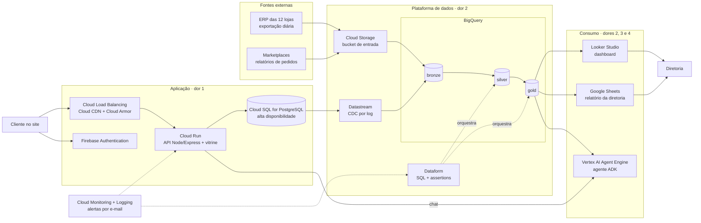

# Proposta de Arquitetura em Nuvem (GCP)
*Nota do PMO: O MVP Lojas Horizonte foi construído e executado localmente via Docker Compose devido a restrições de sandbox. Este documento serve como Proposta Técnica e Estimativa de Custos para o ambiente de Produção do Cliente.*

## 1. Componentes da Arquitetura
Para suportar datas de pico (ex: 11/11 ou Black Friday), sem apresentar inatividade ou lentidão, a infraestrutura ideal no Google Cloud será:
- **Cloud Run:** Hospedagem da aplicação Web e API Node.js/Express. Escolhido por permitir auto-scaling instantâneo a partir de zero, absorvendo picos sem intervenção manual.
- **Cloud SQL (PostgreSQL):** Banco de dados relacional para lidar com o alto volume de inserções da tabela `analytics_events` e catálogo de produtos em Alta Disponibilidade (HA).
- **BigQuery:** Data Warehouse empresarial. Receberá dados paralelamente para as análises de BI e cálculo do Abandono de Carrinho sem onerar o banco de produção.
- **Firebase Authentication:** Serviço serverless gerido escolhido para a autenticação segura de utilizadores (Google e E-mail/Senha) de forma escalável.

## 2. Estimativa Mensal de Custos (GCP Pricing Calculator)
**Premissas utilizadas para o cenário base (Crescimento de Ecommerce):**
- *Cloud Run:* 4 vCPU, 8GB RAM, estimativa de 5 instâncias ativas durante 30% do mês.
- *Cloud SQL:* 1 instância Enterprise for PostgreSQL (4 vCPU, 16GB RAM) + 100 GB de armazenamento SSD.
- *BigQuery:* 50 GB de armazenamento ativo e 500 GB de processamento de queries/mês.
- *Firebase Authentication:* Escalável gratuitamente até 50.000 MAUs (Monthly Active Users).

**Total Estimado:** ~ $ 450,00 USD / mês (Custos do Firebase absorvidos no Free Tier para a dimensão atual).
**Link da Estimativa Detalhada:** [Clique aqui para acessar a simulação no GCP](COLE_O_SEU_LINK_GERADO_AQUI_OU_INDIQUE_O_PDF)

## 3. Diagrama da solução

Cada bloco responde a uma dor do cliente: aplicação (dor 1, site instável no pico), plataforma de dados (dor 2, dados espalhados e relatórios à mão), consumo (dores 2, 3 e 4: dashboard, abandono de carrinho e recomendação).

**Como ler:** o site grava no Cloud SQL e nunca consulta a plataforma de dados (a loja não depende da análise). O Datastream copia as mudanças do banco para o BigQuery lendo o log do Postgres, sem consultar as tabelas da loja. ERP e marketplace chegam como arquivos no Cloud Storage. O Dataform transforma bronze → silver → gold, e todos os consumidores leem só a gold.

## 4. Camada de dados

### 4.1 Serviços e justificativas

| Serviço | Papel | Por que este | Alternativa descartada |
|---|---|---|---|
| **Cloud Storage** | Entrada dos arquivos do ERP e dos marketplaces (bucket de entrada, uma pasta por fonte) | Barato, durável e lido direto pelo BigQuery (tabela externa ou carga). Guarda o arquivo original para reprocessar | Gravar direto no BigQuery a partir do ERP: perde o arquivo original e acopla o ERP ao formato das tabelas |
| **Datastream** | CDC do Cloud SQL (pedidos, itens, eventos, avaliações) para a bronze | Lê o log do Postgres: captura exclusões e estados intermediários sem pesar no banco da loja durante o pico. Serverless, entrega direto no BigQuery | CDC por consulta (marca d'água no `updated_at`, como no MVP): não vê exclusões e consulta o banco da loja. Debezium + Pub/Sub: mesmo resultado, mas com infraestrutura para manter |
| **BigQuery** | Data warehouse com os datasets `bronze`, `silver` e `gold` | Serverless (sem cluster para dimensionar), cobra por dado lido ou por capacidade, integra nativamente com Datastream, Dataform, Looker Studio, Sheets e Vertex AI | Databricks no GCP: mais poderoso para Spark e ML, mas exige gerir workspace e compute; para o porte da Horizonte (SQL e poucos milhões de linhas), BigQuery + Dataform é mais simples |
| **Dataform** | Transformações em SQL versionadas no Git, ordem pelas dependências, testes (*assertions*) | Nativo do BigQuery, sem custo além das consultas que executa, mesmo modelo do MVP (SQL no Git) | Cloud Composer (Airflow gerenciado): custo fixo alto para um único fluxo diário. dbt Cloud: licença à parte |
| **Looker Studio** | Dashboard com os indicadores | Gratuito, conecta direto na gold do BigQuery | Looker: modelagem semântica forte, mas com licença; faz sentido se a Horizonte crescer o time de BI |
| **Google Sheets (Sheets API)** | Relatório da diretoria, atualizado a partir da gold | A diretoria já trabalha em planilhas: o relatório chega pronto, no lugar onde ela já olha, sem montagem manual | Exportar CSV por e-mail: volta ao processo manual que é a dor 2 |
| **Vertex AI Agent Engine** | Hospeda o agente ADK de recomendação (D21), que lê `gold_catalogo` e `gold_avaliacoes` | Ambiente gerenciado para agentes ADK, com conta de serviço própria e modelo Gemini | Agente no próprio Cloud Run da loja: mistura a escala da loja com a do agente |
| **Cloud Monitoring + Logging** | Alertas de falha do Dataform, *assertion* reprovada e atraso do Datastream | Mesmo lugar dos alertas da aplicação (Caio), um único canal de incidentes | Alertas por script próprio: mais código para manter |

### 4.2 Camadas no BigQuery

As regras são as mesmas do MVP (`docs/dados/decisoes.md`):

| Dataset | O que guarda | Regras |
|---|---|---|
| `bronze` | Cópia fiel de cada fonte | Arquivos lidos como texto, com `_arquivo_origem` (pseudocoluna `_FILE_NAME`) e `_ingerido_em` (D05). Do Datastream, tabelas em modo *append-only*: cada mudança vira uma linha, inclusive exclusões, o que preserva o histórico como a bronze do MVP |
| `silver` | Dados limpos e tipados, por fonte, e o modelo estrela unificado (`fato_vendas` + dimensões, D20) | Marca as linhas em vez de removê-las (D07); fica com a versão mais recente de cada registro; horário convertido de UTC para Brasília (`DATETIME`) |
| `gold` | Uma tabela por assunto, sempre com a coluna `canal` (D24) | Só vendas válidas. Tabelas diárias **particionadas por `data` e clusterizadas por `canal`**: uma consulta de um mês lê só aquele mês, o que reduz o custo no modelo por dado lido |

Os consumidores leem só a gold. As dimensões que eles precisam (`dim_data`, `dim_loja`) são publicadas na gold como *authorized views*, como no MVP (D22, D24).

### 4.3 Orquestração e qualidade

- **Frequência:** o Dataform roda a cadeia completa uma vez por dia, depois que o arquivo do ERP chega (agendamento por *workflow configuration*). Pedidos do site chegam continuamente pelo Datastream; a gold do site pode ser atualizada várias vezes ao dia com tabelas incrementais, só com o que mudou.
- **Qualidade:** as 25 checagens do notebook `12_qualidade` viram *assertions* do Dataform (sujeira esperada, reconciliação gold × fato, estoque × vendas). Se uma falhar, a cadeia para antes da gold e o Cloud Monitoring avisa: o dashboard nunca mostra número que não passou na checagem.
- **Por que não streaming na gold:** o problema do cliente é relatório montado à mão. Atualização diária (e de minutos para o site) já resolve, por uma fração do custo de um pipeline contínuo.

### 4.4 Do MVP ao GCP

O MVP roda no Databricks Free Edition (D01) com os mesmos nomes do desenho (D02):

| No GCP (produção) | No MVP (Databricks) | O que muda |
|---|---|---|
| Projeto `lojas-horizonte` | Catálogo `horizonte` | Nada: mesmo papel de contêiner |
| Datasets `bronze`, `silver`, `gold` | Schemas `bronze`, `silver`, `gold` | Nada |
| Bucket de entrada no Cloud Storage | Volume `horizonte.bronze.landing` | Nada: uma pasta por fonte |
| Datastream (CDC por log, contínuo) | `carga_ao_vivo.sh`: exportação por marca d'água no `updated_at` + Job ao vivo (D27) | Produção vê exclusões e não depende de alguém disparar |
| Tabela externa + `CREATE TABLE AS SELECT` | `read_files` em SQL (D06) | Sintaxe; mesma estrutura |
| Dataform (SQLX + *assertions*) | Notebooks SQL `00` a `12` + checagens em `gold.dq_resultados` | Dataform deduz a ordem pelas referências entre tabelas |
| Dataform *workflow configuration* | Job `horizonte_pipeline` a partir do `main` (D26) | Nada no conceito: código revisado, cada execução ligada a um commit |
| Looker Studio | Dashboard AI/BI do Databricks (Henry) | Ferramenta; mesmas consultas do dicionário da gold |
| Vertex AI Agent Engine | `adk web` local, lendo a gold pelo SQL warehouse (Emanuel) | Hospedagem do agente |
| `roles/bigquery.dataViewer` no dataset `gold` + `roles/bigquery.jobUser` | `GRANT USE SCHEMA, SELECT ON SCHEMA horizonte.gold` + *Can use* no warehouse (D22) | Nada: menor privilégio nos dois |
| Contas de serviço por consumidor | Token pessoal de cada consumidor | Em produção, nenhuma credencial pessoal em aplicação |

Cada transformação tem SQL equivalente ao BigQuery; as principais diferenças de sintaxe (`DECIMAL` → `NUMERIC`, `COUNT_IF` → `COUNTIF`, `from_utc_timestamp` → `DATETIME(ts, tz)` etc.) estão registradas no contexto do projeto, e a versão BigQuery das consultas fica em `sql/bigquery/` (#20).

### 4.5 Comparação com AWS e Azure

**Ponto principal: o data warehouse.**

| Critério | BigQuery (GCP) | Amazon Redshift (AWS) | Azure Synapse / Microsoft Fabric |
|---|---|---|---|
| Modelo | Serverless: nada para dimensionar | Provisionado (nós) ou Serverless (capacidade mínima em RPUs) | Synapse: pool dedicado (provisionado) ou serverless; a Microsoft concentra a evolução no Fabric |
| Cobrança da consulta | Por dado lido (1 TiB/mês grátis) ou por capacidade (slots) | Por hora de nó, ou por RPU-hora enquanto há consulta (mínimo de 60 s por consulta no Serverless) | Por capacidade do Fabric ou do pool dedicado; serverless por dado lido |
| Encaixe na Horizonte | Volume pequeno e consultas esporádicas (dashboard e relatório diário) cabem quase todo na faixa gratuita; partição + cluster mantêm a leitura baixa | Viável, mas há uma capacidade mínima cobrada por hora de uso mesmo para consultas pequenas | Faz sentido para quem já usa Power BI e Microsoft 365; a Horizonte usa Google Workspace |
| Integração com o resto | Datastream, Dataform, Looker Studio, Sheets e Vertex AI nativos | DMS, Glue, QuickSight, Bedrock | Data Factory, Power BI, Azure AI Foundry |

**Conclusão:** BigQuery ganha pelo modelo de cobrança (porte pequeno e uso esporádico) e pela integração com o Google Workspace que a diretoria já usa. Redshift ou Fabric seriam a escolha se a Horizonte já estivesse em AWS ou no ecossistema Microsoft.

**Equivalência dos demais serviços (referência):**

| Função | GCP | AWS | Azure |
|---|---|---|---|
| Containers da API | Cloud Run | ECS com Fargate | Azure Container Apps |
| Banco transacional | Cloud SQL for PostgreSQL | RDS for PostgreSQL | Azure Database for PostgreSQL |
| CDC do banco | Datastream | AWS DMS | Azure Data Factory (CDC) |
| Armazenamento de arquivos | Cloud Storage | S3 | Blob Storage / ADLS Gen2 |
| Transformação SQL | Dataform | Glue / dbt | Data Factory / Fabric |
| Dashboard | Looker Studio | QuickSight | Power BI |
| IA generativa | Vertex AI | Bedrock | Azure AI Foundry |
| Monitoramento | Cloud Monitoring | CloudWatch | Azure Monitor |

### 4.6 Limitações e pontos em aberto

- **Região:** a definir com o PMO. São Paulo (`southamerica-east1`) deixa os dados no Brasil e perto dos clientes, mas costuma ser mais cara que as regiões dos EUA; a estimativa de custos deve usar a mesma região do desenho.
- **Custos da camada de dados:** a estimativa da seção 2 cobre o BigQuery; falta incluir o Datastream (cobrado por volume de dados processado). O Dataform não cobra à parte.
- **Marketplace:** no MVP vem do dataset Olist; em produção, os pedidos chegariam pelos relatórios ou APIs de cada marketplace, já com o SKU do vendedor (D12).
- **Estoque do site:** não existe no MVP (D23); em produção viria do Cloud SQL pelo mesmo Datastream.
- **Acessos:** a matriz de IAM (papéis por pessoa e por conta de serviço) fica na seção de segurança.
