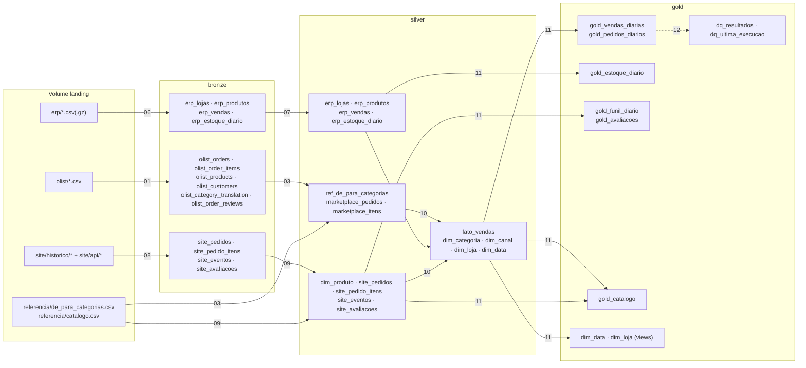

# Pipeline de dados · Lojas Horizonte

Página de entrada da frente de dados: de onde vem cada tabela (linhagem), o que cada camada faz e onde está o resto da documentação.

O pipeline junta três canais de venda numa camada gold única, no padrão medalhão (bronze → silver → gold). Roda no Databricks Free Edition (D01) com o desenho do GCP (D02): catálogo `horizonte`, schemas `bronze`, `silver` e `gold`, arquivos no Volume `horizonte.bronze.landing`.

| Canal | Fonte | Natureza |
|---|---|---|
| Marketplace | Dataset Olist (Kaggle, CC BY-NC-SA 4.0) | Real, com datas deslocadas (D10) e categorias remapeadas (D04) |
| Loja física | `data/geradores/gera_erp.py` | Sintético, calibrado pelo Olist (D17) |
| Site | `data/geradores/gera_site.py` e `gera_avaliacoes.py` + exportação da API | Sintético até 18/11/2026 (D23, D25); depois, pedidos reais da API (D27) |

## Linhagem

Os números nas setas são os notebooks de `pipeline/`. A checagem de qualidade (12) lê a silver e a gold e grava o resultado na própria gold.

### Tabela por tabela

| Tabela | Notebook | Lê de |
|---|---|---|
| `bronze.olist_*` (6 tabelas) | `01_bronze_olist` | `landing/olist/*.csv` |
| `silver.ref_de_para_categorias` | `03_silver_olist` | `landing/referencia/de_para_categorias.csv` |
| `silver.marketplace_pedidos`, `silver.marketplace_itens` | `03_silver_olist` | `bronze.olist_orders`, `olist_order_items`, `olist_products`, `olist_customers` + de-para |
| `bronze.erp_*` (4 tabelas) | `06_bronze_erp` | `landing/erp/` |
| `silver.erp_*` (4 tabelas) | `07_silver_erp` | `bronze.erp_*` |
| `bronze.site_*` (4 tabelas) | `08_bronze_site` | `landing/site/*/{pedidos,pedido_itens,eventos,avaliacoes}/` (histórico e API juntos) |
| `silver.dim_produto` | `09_silver_site` | `landing/referencia/catalogo.csv` |
| `silver.site_*` (4 tabelas) | `09_silver_site` | `bronze.site_*` + `dim_produto` |
| `silver.dim_categoria`, `dim_canal`, `dim_loja` | `10_silver_unificada` | `silver.erp_produtos`, `silver.erp_lojas` |
| `silver.fato_vendas` | `10_silver_unificada` | `silver.erp_vendas`, `marketplace_itens`, `marketplace_pedidos`, `site_pedido_itens`, `site_pedidos`, `dim_categoria` |
| `silver.dim_data` | `10_silver_unificada` | `silver.fato_vendas` |
| `gold.gold_vendas_diarias`, `gold_pedidos_diarios` | `11_gold` | `silver.fato_vendas` |
| `gold.gold_estoque_diario` | `11_gold` | `silver.erp_estoque_diario`, `dim_produto` |
| `gold.gold_catalogo` | `11_gold` | `silver.dim_produto`, `fato_vendas`, `site_avaliacoes` |
| `gold.gold_funil_diario` | `11_gold` | `silver.site_eventos`, `site_pedidos` |
| `gold.gold_avaliacoes` | `11_gold` | `silver.site_avaliacoes`, `dim_produto` |
| `gold.dim_data`, `gold.dim_loja` (views) | `11_gold` | `silver.dim_data`, `silver.dim_loja` |
| `gold.dq_resultados`, `dq_ultima_execucao` | `12_qualidade` | silver e gold |

Fora do pipeline (análises de uma vez, D26): `02_perfil_olist`, `04_calibracao_catalogo` e `05_sazonalidade`, que leem o Olist para calibrar os geradores sintéticos.

## O que cada camada faz

| Camada | Regra | Decisões |
|---|---|---|
| Bronze | Cópia fiel do arquivo: tudo como texto, com `_arquivo_origem` e `_ingerido_em`. Nada é corrigido | D05, D06 |
| Silver | Tipa, converte horários para Brasília e **marca** cada linha (`valido` e marcações por problema). Nenhuma linha é removida. Une os canais no modelo estrela | D07, D08, D18, D20 |
| Gold | Uma tabela por assunto, sempre com `canal`, só com vendas válidas. É a única camada que os consumidores leem | D22, D24 |

A rastreabilidade funciona nos dois sentidos: de um número da gold dá para chegar à linha da silver (pela marcação) e ao arquivo de origem (pelo `_arquivo_origem` da bronze).

## Como roda

Dois Jobs do Databricks, a partir do `main` (D26): `horizonte_pipeline` (completo, cerca de 3,5 minutos) e `horizonte_site_ao_vivo` (só o caminho do site, para a carga ao vivo da API, D27). Detalhes e comandos em [`databricks/README.md`](../../databricks/README.md).

## Onde está o resto

| Documento | Conteúdo |
|---|---|
| [`dicionario_gold.md`](dicionario_gold.md) | Contrato da gold: colunas, regras, consultas dos indicadores e valores de referência |
| [`decisoes.md`](decisoes.md) | Registro de decisões (D01 em diante), com motivo e alternativas descartadas |
| [`../architecture/gcp.md`](../architecture/gcp.md) | Arquitetura no GCP e equivalência com o MVP |
| [`../architecture/iam.md`](../architecture/iam.md) | Matriz de acessos do MVP e do GCP |
| [`../../sql/bigquery/`](../../sql/bigquery/) | Versão BigQuery das transformações |
| [`../../data/geradores/parametros.yaml`](../../data/geradores/parametros.yaml) | Todos os números dos dados sintéticos |
